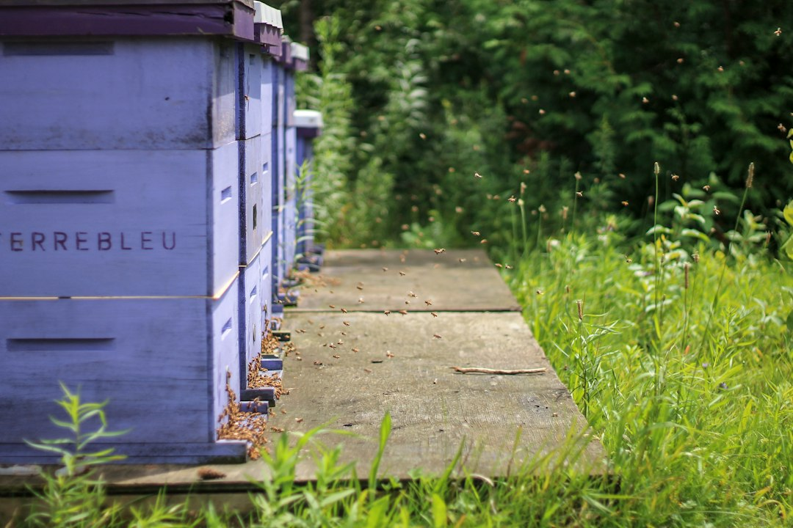

*This post contains affiliate links. As an Amazon Associate, I earn from qualifying purchases at no extra cost to you.*

Most colonies that miss the spring flow did not fail because of the flow. They failed in February and March, when the population was too small to turn nectar into a honey crop. A colony that peaks two weeks after the main bloom has wasted its best weeks, and summer feeding cannot recover that timing.

The fix is not to feed every hive heavily and hope. Spring buildup is a sequence: protect the stores the colony already has, support the queen's laying rate with the right food at the right temperature, and read the brood pattern so you know which problem you actually have. Feeding is a tool for specific gaps, not a default routine. A hive with stored honey, incoming pollen, and a tight brood pattern needs patience more than another gallon of syrup.

My position is simple: feed less syrup than most beginners do, watch the brood more than the feeder, and make every intervention answer a question you can verify by looking at the frames. This guide covers the timeline, feeding choices, brood signals, and a table linking symptoms to actions. It draws on extension guidance, manufacturer specifications, and documented colony biology, so adjust timing to your local flow dates.

Photo by <a href="https://unsplash.com/@captain_adi?utm_source=artlines_blog&utm_medium=referral">Addy Badal</a> on <a href="https://unsplash.com/?utm_source=artlines_blog&utm_medium=referral">Unsplash</a>

## Why Spring Buildup Strategies Start Before the First Flowers

A colony does not wait for flowers to start growing. In many temperate regions, queens resume laying in late winter as day length increases, using stored honey for energy and any available pollen for protein. The cluster holds the brood nest near 93 to 95 degrees Fahrenheit, and that heating burns fuel. The more brood the colony raises, the faster it consumes stores.

That is the central tension of early spring. More brood means a stronger colony in six weeks, but also more honey consumed now, when little is coming in. Colonies that survived the cold can still starve in March because the brood nest expanded faster than the nectar arrived.

So your first spring job is a stores check, not a feeding schedule. Hefting the back of the hive, or looking at the top bars on a warm day, tells you whether the colony is within a week or two of running out. If it is, feeding is an emergency and the form of food matters. If stores are healthy, your task is timing the buildup so the worker population peaks as your main flow begins.

Work backward from your flow date. Workers take 21 days to develop from egg to adult, and they spend roughly the first three weeks of adult life inside the hive before they forage. The bees that gather your main flow were therefore laid about six weeks earlier. If your flow starts in mid-May, the critical laying window is late March through early April.

Local bloom matters more than the calendar. Red maple, willow, dandelion, and fruit bloom trigger pollen intake, and the colony responds to that more than to anything you place on the hive. To follow the population curve, [How To Read Your Hives Population Through The Season](/2026/06/12/how-to-read-your-hives-population-through-the-season/) pairs well with this timeline.

## Reading Brood Patterns Before You Change Anything

A brood pattern is the best single readout of queen quality, nutrition, and disease pressure. Before you add syrup, a patty, or a box, look at two or three frames from the center of the nest and decide what you are seeing.

A strong pattern is compact and solid. Capped worker brood fills most cells in a continuous, roughly oval patch with few empty cells. Many keepers use about 85 to 90 percent coverage inside the brood area as a rough benchmark for a good queen. Look for eggs standing upright in the cell bottoms, pearly white larvae, and a band of pollen and honey arching over the top of the frame.

A weak pattern shows gaps, scattered capped cells mixed with empty ones, or brood spread thinly over many frames. The cause is not always the queen. Spotty brood can come from a failing or poorly mated queen, inbreeding, disease, chilling when the cluster is too small to cover the brood, or workers cleaning out cells because of mites or pests. Separate these before you act.

Check these points on each inspection:

- **Egg presence:** Fresh eggs mean the queen is laying now, even if the capped pattern looks poor.
- **Cell caps:** Flat or slightly domed tan caps are normal. Sunken, greasy, or perforated caps call for a disease check.
- **Larvae:** Pearly white, C-shaped larvae are healthy. Yellow, brown, or twisted larvae are not.
- **Pollen nearby:** Pollen stored beside brood suggests the nurses have protein available.
- **Drone brood:** Raised drone cells on frame edges are normal in spring. Drone cells scattered across worker brood may suggest a laying worker or queen failure.

If you see sunken caps, ropy larvae, or an unpleasant smell, stop optimizing and read [How To Identify And Treat American Foulbrood](/2026/09/22/how-to-identify-and-treat-american-foulbrood/) first. Brood disease is a different problem from a poor buildup.

Photograph each frame you evaluate so you can compare week to week without keeping the hive open. A frame lifter such as the [KINGLAKE Steel J Hook Bee Hive Tool Frame Lifter and Scraper](https://www.amazon.com/dp/B010NBUC08?tag=mbbeekeeping-20) helps you pull the first frame and lift each one out, and it doubles as a scraper for propolis.

## Feeding for Spring Buildup: Syrup, Timing, and Feeders

Spring feeding has two different purposes, and mixing them up leads to mistakes.

**Emergency feeding** prevents starvation. If a colony has little or no honey and is cold, the safest food is solid: a sugar brick, fondant, or dry sugar placed directly above the cluster. Liquid syrup at low temperatures is hard for bees to take down, and it adds moisture to the hive.

**Stimulative feeding** encourages brood rearing when stores are adequate but nectar is not yet flowing. A 1:1 ratio of sugar to water is the usual spring mix because it resembles light nectar. Heavier 2:1 syrup is a fall mix for storing weight, not a spring buildup tool.

The temperature rule is firm. Bees must break cluster to take liquid, and extension guidance generally treats about 50 degrees Fahrenheit as the practical floor for liquid feeding. If your forecast stays below that, use solid feeds and wait for a warm spell.

**Choosing a feeder.** Feeder choice affects robbing risk, heat loss, and how often you must open the hive.

- **Top or in-hive feeders** keep syrup inside the box, close to the cluster, and reduce robbing. They are usually best for full-size colonies in cold or variable weather.
- **Frame feeders** sit in the box like a frame but can drown bees if no float or ladder is present.
- **Entrance feeders** hold syrup at the entrance. They are the easiest to refill without opening the hive, but they invite robbing and expose syrup to cold air.

For small colonies, nucs, or splits, the [KEILEOHO 12 Pack 5.5 x 3.15 in Bee Feeder, Beehive Entrance Feeder with Lids](https://www.amazon.com/dp/B08LQMYK31?tag=mbbeekeeping-20) is one option, mostly because a 12 pack lets you equip several hives and keep spares. The tradeoff is capacity: a feeder this size holds limited volume, so a larger colony may empty it quickly. Use entrance feeders only in warm weather, reduce the entrance to limit robbing, and remove them if wasps or neighboring bees investigate. For starting or dividing colonies, see [Best Nuc Boxes And Feeders For Starting Or Splitting Colonies](/2026/08/22/best-nuc-boxes-and-feeders-for-starting-or-splitting-colonies/).

**How much to feed.** Feed only what the colony will take in a few days. Small, frequent portions of 1:1 syrup, a quart or less at a time for a small colony, are easier to manage than a large reservoir that ferments. Stop when natural nectar begins, usually when you see fresh white wax and bees returning with loaded pollen baskets. Syrup left on during a flow can end up in your honey supers, which is a quality and legal problem if you sell honey.

## Pollen and Protein Supplements for Brood Pattern Optimization

Carbohydrate drives the cluster's heat, but protein builds bees. Nurses make the jelly that feeds larvae from pollen. If pollen is scarce in early spring, nurses draw on their own body reserves, and the brood pattern thins as the colony cuts back on rearing.

Check for natural pollen first. If you see multicolored pollen loads at the entrance and pollen stored beside brood, a patty adds little. If the weather is cold and rainy, or your area has a gap between early pollen sources, a supplement can bridge the shortage.

Commercial substitutes and patties are formulated with protein from sources like soy and yeast. Some contain real pollen, which bees often accept more readily. Place small patties directly over the brood nest on the top bars, replace them only when most of the first is gone, and remove leftovers once natural pollen arrives.

The risks are real. Large patties can attract small hive beetles in warm climates, and overfeeding can push the colony to rear more brood than it can keep warm during a late cold snap. That chilled brood shows up later as exactly the patchy pattern you were trying to prevent.

Match the supplement to colony size. A cluster covering three frames cannot cover a rapidly expanding brood nest, so pushing a tiny colony can backfire. A cluster covering six or more frames and bringing in some nectar is a better candidate. For ingredients, timing, and year-round planning, read [Pollen And Protein Feeding Strategies For Year Round Colony Development](/2026/10/08/pollen-and-protein-feeding-strategies-for-year-round-colony-development/). Planting early-blooming sources also shortens your supplement schedule, and [Growing Bee Friendly Plants For Maximum Nectar And Pollen](/2026/09/13/growing-bee-friendly-plants-for-maximum-nectar-and-pollen/) covers species worth adding.

Disease and mites also reduce the pollen benefit. A colony loaded with Varroa or fighting Nosema converts food into bees less efficiently, so good protein will not fix a pest problem. If you see deformed wings, spotting on the boards, or poor buildup despite ample food, consult [Varroa Mite Management Strategies Without Chemical Treatments](/2026/09/17/varroa-mite-management-strategies-without-chemical-treatments/) and [Treating Nosema In Honey Bee Colonies](/2026/07/26/treating-nosema-in-honey-bee-colonies/).

## A Spring Buildup Plan, Step by Step

Details change with region, but this sequence holds for most temperate climates. Adjust the dates to your bloom calendar and flow start.

1. **Late winter check (on a mild day, no opening below about 50 degrees):** Heft the hive from the back to judge weight, or look through the top for cluster position and stores. If the colony is light, place a sugar brick or fondant directly above the cluster. Do not break the cluster apart.
2. **First warm inspection (above roughly 55 to 60 degrees, little wind):** Confirm the queen is present by finding eggs. Check stores, count frames of bees, and evaluate the brood pattern. Photograph two center frames and record the numbers in your log. When propolis has glued everything shut, a stainless steel pair like the [WEICHUAN 2PCS Stainless Steel Hive Scraper Tools](https://www.amazon.com/dp/B07THTXXRZ?tag=mbbeekeeping-20) can scrape burr comb and propolis off frame tops and box rims.
3. **Clean up the nest:** Remove dead bees from the bottom board, scrape excess wax and propolis, and replace broken or heavily damaged frames. Reduce the entrance if robbing pressure or cold winds are an issue.
4. **Decide on feeding:** If stores are low, feed 1:1 syrup in warm weather. If pollen is scarce and the colony is strong enough to use it, add a small patty above the brood. If stores and pollen are fine, do nothing.
5. **Reposition frames carefully:** As the brood nest grows, place empty drawn comb next to the outer edge of the brood area, never inside the cluster during a cold stretch.
6. **Re-inspect every 7 to 10 days:** Look for egg laying, expanding brood area, and stores. Add a box only when the bees cover nearly every frame in the current one.
7. **Prepare for swarm season:** When drone brood increases and the colony is crowded, plan your response. A split can protect your honey crop, and [How To Split A Hive To Prevent Swarming](/2026/05/28/how-to-split-a-hive-to-prevent-swarming/) explains the process.
8. **Stop feeding at the flow:** When nectar is coming in, remove syrup feeders and add honey supers before the colony runs out of space.

The discipline in step 4 matters most. Feeding by calendar date is a habit; feeding in response to a measurable gap is management. For tool choices beyond the basics, [Best Beekeeping Tools Buyers Guide](/2026/06/12/best-beekeeping-tools-buyers-guide/) covers hive tools, smokers, and protective gear.

## Matching Brood Pattern Symptoms to Actions

Use this table when an inspection leaves you uncertain. It lists common spring brood findings, the likely cause, and the most defensible response. Confirm with a second inspection before a major change such as requeening.

| What you see | Likely cause | Practical action |
|---|---|---|
| Solid capped pattern, eggs present | Healthy queen, adequate food | No change; keep monitoring stores |
| Small brood patch, few bees | Weak or small colony, cold stress | Reduce space, protect stores, consider combining |
| Scattered cells, many empty | Queen aging, poor mating, or inbreeding | Recheck in 7 to 10 days; plan to requeen if pattern persists |
| Spotty brood plus sunken or perforated caps | Possible brood disease | Test and follow disease guidance before anything else |
| Brood present but little pollen, thin larvae | Protein shortage | Offer a small pollen patty; ensure forage is available |
| Many drone cells in worker comb, multiple eggs per cell | Laying workers or drone-laying queen | Confirm queenlessness; requeen or combine |
| Good pattern but few foragers | Cold weather, mite load | Check Varroa levels; wait for warmer weather |
| Brood chilled, dead larvae outside cluster | Late cold snap after rapid expansion | Reduce entrance, tighten the nest, avoid overstimulation |

In most rows, the first action is to observe, reduce, or confirm, not to add feed. Many problems that look like feeding issues turn out to be queen, disease, or weather problems, and food does not solve them.

When the pattern stays poor after two inspections and you have ruled out disease and starvation, the queen is the likely issue. For timing and sourcing, see [Requeening A Weak Hive When And How To Replace A Failing Queen](/2026/10/15/requeening-a-weak-hive-when-and-how-to-replace-a-failing-queen/) and [Where To Buy Queen Bees What To Look For And How To Order](/2026/06/09/where-to-buy-queen-bees-what-to-look-for-and-how-to-order/).

## Common Spring Buildup Mistakes to Avoid

Most weak buildups trace back to a handful of avoidable errors.

**Feeding syrup in cold weather.** Bees cannot take liquid below about 50 degrees without leaving the cluster, and cold syrup can chill them. Use solid feed until the forecast warms.

**Overfeeding syrup and backfilling the brood nest.** Heavy feeding can fill cells the queen needs for eggs, squeezing her laying space and possibly triggering swarming. If you see syrup stored in the center frames, stop feeding.

**Using 2:1 syrup in spring.** Thick fall syrup is for storing weight. In spring, 1:1 is easier to process and better matches the goal of stimulation.

**Opening the hive too often or too early.** Every cool-weather inspection costs the colony heat. Keep early checks brief, work on warm days, and have your plan ready before you break the seal.

**Splitting the brood nest.** Empty frames placed in the middle of the cluster can leave brood exposed on a cold night. Add space at the edges.

**Leaving patties and feeders on after the flow starts.** Syrup in supers contaminates honey, and old patties draw hive beetles.

**Ignoring mites and Nosema.** A colony fighting pests cannot convert food into bees efficiently. Check Varroa counts before and during buildup, and review [Early Warning Signs Your Bee Colony Is In Trouble](/2026/09/19/early-warning-signs-your-bee-colony-is-in-trouble/) to catch trouble early.

**Feeding robbers instead of your bees.** Sloppy spills and large entrances during a dearth invite robbing. Reduce entrances, wipe spills, and consult [Identifying And Stopping Honeybee Robbing Before It Spreads](/2026/10/24/identifying-and-stopping-honeybee-robbing-before-it-spreads/) if neighbors begin probing the hive.

**Not recording what you see.** If you cannot compare this week's brood to last month's, you cannot tell whether your changes helped. [Creating And Maintaining Inspection Logs For Tracking Hive Health Data](/2026/10/06/creating-and-maintaining-inspection-logs-for-tracking-hive-health-data/) offers a format that works for small apiaries.

## Frequently Asked Questions

### When should I start feeding bees in spring?

Start with a stores check, not a date. If the hive is light, give solid feed such as fondant or a sugar brick in late winter. Begin 1:1 syrup only when daytime temperatures are consistently above about 50 degrees. If the colony has plenty of capped honey and early pollen is arriving, you may not need syrup at all. Extension guidance generally favors feeding in response to a measured shortage, because unnecessary feeding can crowd the brood nest and push colonies toward early swarming.

### Does feeding syrup actually improve my brood pattern?

Syrup supplies energy for brood rearing, but it does not repair a pattern caused by a weak queen, disease, or mites. Feeding helps when the underlying problem is low stores or a stalled nectar supply that makes the colony restrict laying. If the pattern does not improve in two to three weeks, investigate the queen's age and mating, check Varroa levels, and look for brood disease rather than adding more syrup.

### How do I know if the queen is the problem?

Look for eggs, then judge consistency. A good queen lays one egg per cell in a tight pattern. A scattered pattern, multiple eggs per cell, or mostly drone brood in worker cells suggests a failing queen. Rule out disease and cold stress first, because they can mimic a bad queen, and recheck after seven to ten days. If the pattern remains poor and food is adequate, plan to requeen, and check regional queen availability because early-season replacement can be difficult.

### Should I use pollen patties every spring?

No. Use them when natural pollen is scarce, such as during cold, wet weather or a gap before major bloom. If bees are storing pollen near brood, patties add little and may attract small hive beetles. Offer small patties above the brood nest, replace them only after most is consumed, and remove leftovers when natural forage appears. Very weak colonies may not use the patty quickly.

### How much brood should a colony have by the start of the main flow?

There is no universal number, because it depends on hive type and region. A common goal is a brood chamber full of bees with most frames covered when the main flow begins, the brood nest large, and the population still growing. Using the 21-day development cycle, aim for peak laying about six weeks before the flow. Track frames of bees and brood in your log and compare against your own previous seasons.

Spring buildup comes down to timing, observation, and restraint. Check stores first, use solid feed in cold weather and thin syrup only when bees can take it, add protein when pollen is genuinely scarce, and read the brood pattern before you change anything. A tight, expanding brood nest six weeks before your flow will do more for your honey crop than any feeding product.

Your next action is simple: pick the first warm day in your late winter window, inspect two center frames in each hive, photograph them, and write down stores, eggs, and brood coverage. That baseline tells you which section of this guide applies to each colony. To compare seasonal feeding and colony management advice against your own region, the [Penn State Extension beekeeping resources](https://extension.psu.edu/) and the [Honey Bee Health Coalition](https://honeybeehealthcoalition.org/) are reliable places to start.

Bookmark this page for your late winter inspection, and leave a comment with your region and flow dates so other readers can compare timelines.

**Related Reading**

- [How To Read Your Hives Population Through The Season](/2026/06/12/how-to-read-your-hives-population-through-the-season/)
- [Creating And Maintaining Inspection Logs For Tracking Hive Health Data](/2026/10/06/creating-and-maintaining-inspection-logs-for-tracking-hive-health-data/)

  
<strong>About the Author</strong>

  
The MB Beekeeping team researches backyard beekeeping practices, drawing on apiary science literature, extension service recommendations, and documented keeper outcomes. Our guides focus on practical hive management decisions that hold up under scrutiny.

