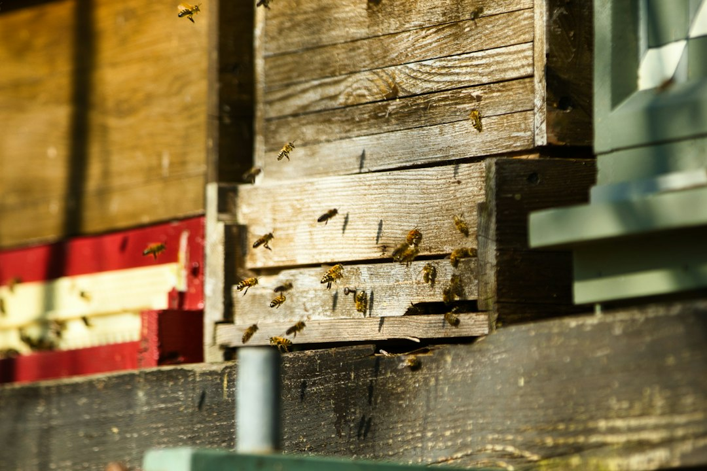

*This post contains affiliate links. As an Amazon Associate, I earn from qualifying purchases at no extra cost to you.*

A queen is only as good as the brood she leaves behind. You can admire a big, bright queen on a frame all day, but the colony's future depends on whether she lays fertilized eggs in tight, consistent arcs and whether those eggs survive to emerge as healthy workers. That is why experienced beekeepers judge a queen by her brood first and her appearance second.

This guide shows you how to turn a frame of brood into usable data. You will learn what a healthy pattern looks like, how to separate a queen problem from a disease or mite problem, how to score frames in a repeatable way, and when the evidence is strong enough to replace her. The position here is simple: a single spotty frame proves almost nothing, but three consistent inspections over a month prove a lot. Judge the trend, not the snapshot.

It is early November, so depending on your climate you may have little or no brood to inspect right now. That is fine. Use this season to review your notes, plan spring requeening, and decide what equipment you need. The sections below cover both the inspection method and the off-season planning.

Photo by <a href="https://unsplash.com/@paws_and_prints?utm_source=artlines_blog&utm_medium=referral">𝕡𝕒𝕨𝕤 𝕒𝕟𝕕 𝕡𝕣𝕚𝕟𝕥𝕤</a> on <a href="https://unsplash.com/?utm_source=artlines_blog&utm_medium=referral">Unsplash</a>

## What Brood Pattern Tells You About Queen Quality

Brood pattern is the visible record of three things at once: how well the queen mated, how well she lays, and how healthy the colony is around her. A queen who mated with a dozen or more drones carries a large, diverse supply of sperm, fertilizes nearly every egg she lays, and produces a dense, even field of worker brood. A poorly mated queen runs short on sperm or carries too little genetic diversity, and the pattern shows it with scattered empty cells and too many drone cells in the worker area.

The catch is that the pattern is a composite signal. The queen lays, nurse bees feed the larvae, and hygienic workers remove anything that looks sick or dead. A skipped cell can come from any of those steps. A queen who lays perfectly can still leave a ragged frame behind if nurses uncap and remove infested or diseased pupae. That is why you should treat brood pattern as the first clue in an investigation, not a verdict.

For reference, a productive queen at peak season can lay somewhere between 1,000 and 2,000 eggs per day, and a standard deep frame holds roughly 6,000 to 7,000 worker cells counting both sides. Many keepers treat 85 to 90 percent solid capped brood across the central frames as the benchmark for a good queen, and anything under about 80 percent that persists deserves attention. Those are rules of thumb rather than laboratory thresholds, but they give you a consistent yardstick.

Why does this matter more than a queen's size, color, or marking? Because brood is the outcome you actually care about. A beautiful queen with a poor pattern is a failing queen, and a plain-looking queen with a wall-to-wall pattern is an asset. Brood quality also compounds. A strong pattern in spring means a larger foraging force six weeks later, which means more honey and a healthier winter cluster. If you plan to sell honey or nucs, that makes pattern assessment a business decision as well as a husbandry one. The [Honey Bee Health Coalition](https://honeybeehealthcoalition.org/) publishes colony health references that are worth bookmarking alongside your inspection notes.

## How to Read Eggs, Larvae, and Cappings

Before you score a pattern, you need to know what each stage should look like and how long it lasts. Worker development follows a fixed clock, and that clock lets you date a frame precisely.

**Eggs** last three days. A good queen places a single egg at the center of the cell base, standing upright on day one and leaning over by day three. Multiple eggs per cell, eggs stuck to the cell walls, or eggs scattered at odd angles are signs of a very young queen, a laying worker, or a queen running short of space.

**Open larvae** last roughly five to six more days. Healthy larvae are pearly white, curled in a C shape, and sit in a glistening bed of royal jelly and brood food. Gray, yellow, brown, or sunken larvae are a disease flag and belong in a different conversation than queen quality.

**Capped worker brood** appears around day eight or nine after the egg is laid and stays sealed until emergence at about day 21. Healthy cappings are tan to light brown, slightly convex, and uniform across the frame. Drone cappings are larger and dome noticeably, like small bullets. Capped worker cells that look sunken, greasy, or perforated warrant a closer look for disease.

This timeline lets you do something useful: read the frame as a calendar. If you see eggs, young larvae, and capped brood in concentric bands, the queen has been laying steadily for at least three weeks. If you see eggs but no larvae, something is removing larvae. If you see capped brood but no eggs, she may have stopped laying within the last week or two, which is a serious signal.

Also check the geometry. A good queen lays outward in a spiral or arc, fills one frame area before moving to the next, and leaves a defined band of pollen and a rim of honey above the brood. A queen who skips frames, lays in several disconnected patches, or spreads thin across five frames with no concentrated center is telling you she is struggling or being crowded out by nectar.

## How to Assess Brood Pattern Step by Step

The method below takes about ten minutes per colony once you have done it a few times. The key is consistency: use the same frames, the same scoring approach, and the same notes every time so you can compare inspections.

1. **Pick the right conditions.** Inspect on a warm, calm midday when foragers are flying, ideally above 60 degrees Fahrenheit. Cold weather chills open brood, and rushing in poor light causes you to miss eggs.
2. **Open gently and find the brood nest.** Work from the outside in, set the first frame aside safely, and locate the center of the nest. Check two to three central frames rather than the edges.
3. **Hold the frame flat and over the hive.** Angle the frame so light falls over your shoulder into the cells. Eggs are hard to see with the sun in your eyes. If the queen falls off, she lands in the box rather than the grass.
4. **Estimate percent solid on each side.** Imagine a grid dividing the laying area into 10 rows. Count how many rows are mostly filled, then adjust for scattered empty cells. Record both sides separately.
5. **Check the stages.** Look for eggs, open larvae, and capped brood. Note whether each stage is present, and whether any larvae look off in color or position.
6. **Check drone brood.** Note whether drone cells are confined to the lower corners and edges, which is normal, or scattered through the worker area, which is a warning.
7. **Record the result in your log.** Write the date, weather, percent solid, stages present, and anything unusual. A simple system works better than a detailed one you stop using. If you do not already keep records, the guide on [creating and maintaining inspection logs](/2026/10/06/creating-and-maintaining-inspection-logs-for-tracking-hive-health-data/) walks through a practical format.
8. **Repeat in two to three weeks.** One reading is a data point. Three readings form a trend you can act on.

### Seasonal timing matters

In late fall and winter, the queen cuts back laying dramatically, and in cold regions she may stop entirely. A small, compact patch of brood in November is normal and says little about her quality. Do not open a cold cluster to check; the chilling risk outweighs anything you would learn. Instead, treat autumn as the time to review your spring and summer scores, flag colonies with repeated weak patterns, and line up replacement queens. Your first true assessment of a queen's quality each year should come in early spring, once brood rearing ramps up and the weather allows a safe, quick inspection.

## Brood Pattern Problems Compared: Causes and Fixes

Once you have your readings, the next question is what they mean. The table below summarizes the most common patterns, what usually causes them, and what to do first. Always rule out colony-level causes before you blame the queen.

| Pattern you see | Most likely cause | First step |
|---|---|---|
| Solid, uniform, 85%+ capped | Healthy, well-mated queen | Keep her and log the score |
| Scattered empty cells, mixed ages | Hygienic removal, varroa, or inbreeding | Run a mite count and review the pattern again in 2 weeks |
| Drone cappings in worker cells | Failing queen or drone-laying queen | Look for eggs and confirm; plan replacement |
| Multiple eggs per cell, eggs on walls | Young queen, or laying workers | Check for a queen; consider requeening or combining |
| Eggs but no larvae | Larvae being removed or starved | Check food stores and disease signs |
| Sunken, greasy, or perforated cappings | Possible brood disease | Test for foulbrood and contact your inspector |
| Brood confined to a small patch in summer | Weak queen, crowding, or dearth | Check space, feed if needed, reassess |

### A decision framework: keep, watch, or replace

Use three simple rules to turn the data into a decision.

**Keep** the queen if your last two or three inspections show 85 percent or better solid brood, stages present in order, and drones confined to the edges. Do nothing and keep logging.

**Watch** the queen if one inspection scored 70 to 85 percent, or if the pattern looks good but the colony seems light on adult bees. Rule out mites, nectar flow gaps, and chilled brood, then reinspect in two weeks.

**Replace** the queen if three inspections across at least a month stay below roughly 80 percent after you have corrected mites, feed, and space, or if you see persistent drone-laying, no eggs, or clearly failing performance. At that point, further waiting costs you colony strength you cannot recover. The guides on [requeening a weak hive](/2026/10/15/requeening-a-weak-hive-when-and-how-to-replace-a-failing-queen/) and [where to buy queen bees](/2026/06/27/where-to-buy-queen-bees-what-to-look-for-and-how-to-order/) cover timing, introduction, and sourcing.

One caution on disease. If you see sunken, perforated, or greasy cappings, or a stick test pulls out ropy brown material, treat it as a possible foulbrood case rather than a laying issue. Stop moving frames between colonies and follow the steps in the [American foulbrood guide](/2026/09/22/how-to-identify-and-treat-american-foulbrood/). The University of Minnesota's [Bee Lab](https://beelab.umn.edu/) offers research-based references on brood disease and queen health that can help you confirm what you are seeing.

## Tools for Seeing Brood Clearly

You do not need gadgets to assess a brood pattern. A good hive tool and decent light are enough for most inspections. That said, a few inexpensive tools can make eggs and larvae easier to see, which matters because the earliest signs of a failing queen are often at the egg stage. The products below are candidates for your toolkit rather than essentials, and one of them is a stretch that I will be upfront about.

**A stand magnifier.** The [Carson LumiLoupe 10X stand magnifier](https://www.amazon.com/dp/B000CAHCQS?tag=mbbeekeeping-20) is a simple stand-mounted 10x lens with ambient light. A 10x lens is enough to confirm a single egg at the base of a cell, spot larval color changes, and inspect cappings for pinholes. The tradeoff is that you will use it after the inspection on a frame you have removed, so it suits a bench or tailgate check better than a live one, and propolis on the lens needs wiping regularly. For most beginners learning to identify eggs, it is a very useful optical aid.

**Red light.** Bees perceive red light poorly, so a red light lets you work in dim conditions with less disturbance. The [Xcello LED red light headlamp](https://www.amazon.com/dp/B0CPBTG6PD?tag=mbbeekeeping-20) is a portable USB headlamp marketed for hunting and beekeeping. It is most useful for evening inspections, checking a dark corner of a deep box, or reviewing frames in a shed. Keep in mind that red light reduces contrast on some colors, so egg visibility can be slightly harder than under white light. Use it for low-disturbance work and switch to white light when you need to confirm fine details.

**A borescope, with caveats.** The [dual-lens 1080P endoscope camera](https://www.amazon.com/dp/B0DWSKVF5H?tag=mbbeekeeping-20) is a plumbing and automotive inspection tool, not a beekeeping product. I mention it because some keepers explore inspection cameras for checking cavities such as wall voids, empty boxes, or stored equipment without disassembly. Be cautious about pushing a flexible probe into a live brood nest. It can crush larvae, agitate bees, and be difficult to sanitize between colonies, which raises disease-transfer risk. Treat it as an optional, off-hive tool for looking inside stored supers or cleaning verification, and disinfect it carefully if you use it near any suspect equipment.

If you need to prioritize, buy the magnifier first, add the red light second, and skip the borescope unless you already have a separate need for it. For a wider look at what else to carry, the [beekeeping tools buyer's guide](/2026/06/12/best-beekeeping-tools-buyers-guide/) covers hive tools, brushes, and smokers.

## Common Mistakes When Judging Queen Quality

Most bad queen decisions come from a small set of avoidable errors. Watch for these before you order a replacement.

**Judging by one frame.** A frame at the edge of the nest will always look patchy because the queen tapers off there and workers store pollen and nectar in the gaps. Score the central frames, and score at least two of them.

**Ignoring varroa.** Mite-parasitized pupae are often removed or die, leaving gaps that mimic a bad queen. If your pattern is spotty, do a mite count before you do anything else. The article on [varroa mite management without chemical treatments](/2026/09/17/varroa-mite-management-strategies-without-chemical-treatments/) explains how to sample and when to act.

**Inspecting in poor weather.** Cold or rainy inspections chill brood and make it harder to see eggs. Wait for a warm midday, work quickly, and close the hive.

**Replacing too early after a disruption.** A queen who has recently been moved, split, or introduced often lays erratically for a week or two. Give her time to settle before concluding she is a poor performer.

**Missing laying workers.** Several eggs per cell and drone cappings across worker comb are signs of laying workers, not a failing queen. Replacing a queen into a hopelessly queenless colony usually fails. Check carefully before you spend money on a new queen.

**Skipping record-keeping.** Without notes, you remember the worst frame and forget the best. A short log with percent solid and the date makes the difference between a guess and a decision.

**Replacing a queen that is simply out of space.** A colony backfilling the brood nest with nectar during a strong flow can look like queen failure. Add supers or empty comb, then reassess.

**Assuming age equals failure.** Queens vary. A three-year-old queen with a solid pattern is not a problem, and a one-year-old queen with a poor pattern is. Judge the performance, not the birthday.

## FAQ

**How much spotty brood is too much?**

Most keepers get concerned when a frame in the main brood area shows capped brood below roughly 80 percent solid, and they act when that holds across three inspections spread over several weeks. A single spotty frame near the edge of the nest is normal, because queens taper off toward the margins and workers use some cells for pollen and nectar. Check the center frames instead. Before blaming the queen, rule out chilled brood, a recent nectar dearth, and varroa damage, since all three punch holes in an otherwise good pattern. If the center frames stay patchy after you correct those factors, the queen is the likely cause and replacement is reasonable.

**Can I assess a queen in the fall or winter?**

Only partly, and usually you should not try to. In fall, queens reduce laying, and in cold regions the brood nest shrinks to a small patch or disappears altogether, so a sparse pattern in November tells you very little about her quality. Opening a cold cluster also risks chilling the colony for no real gain. A better approach is to review your spring and summer inspection notes, flag any colony that scored poorly more than once, and plan to requeen in spring or early summer. If a colony is clearly failing in autumn, a combination with a stronger colony is often the practical answer rather than introducing a new queen late in the season.

**What is the difference between a bad queen and a diseased colony?**

A bad queen produces a pattern that is spotty but whose individual cells look healthy: white curled larvae, clean tan cappings, and a normal smell. A diseased colony produces brood that looks wrong in itself, such as discolored or twisted larvae, sunken or perforated cappings, a foul odor, or a stringy residue when you probe a cell with a stick. If you see any of those signs, stop and test for brood disease before you requeen. Replacing a queen in a diseased colony does not fix the underlying problem, and moving equipment between hives can spread it. Contact your state apiarist if you suspect foulbrood.

**Is drone brood in the middle of the frame always a bad sign?**

A small amount of drone brood is normal, particularly in spring, and it is usually found in the lower corners or along the edges of frames where bees build larger cells. What matters is scattered, dome-shaped cappings in the middle of the worker area, which suggests the queen is running out of sperm or is a drone layer. Look at the pattern over several inspections. If most of the capped brood is domed and eggs are laid in a haphazard way, the queen is failing and should be replaced. If the drone brood is confined to the margins and the worker pattern is solid, you can safely ignore it.

## Conclusion

Brood pattern is the most direct evidence of queen quality you will ever see, and it costs nothing but ten minutes and a notebook. Score the central frames, look at eggs, larvae, and cappings together, rule out mites, disease, and space problems, and only then decide whether the queen is the issue. A trend across three inspections is worth far more than any single frame.

Your next action is concrete: open your inspection notes this week, mark any colony that scored below 80 percent more than once, and put those colonies at the top of your spring requeening list. If you do not have notes yet, set up a one-page log before your first spring inspection.

Bookmark this guide so you have the scoring steps handy at your first spring inspection, and leave a comment with the patterns you are seeing in your colonies.

**Related reading**

- [Re-Queening Your Hive: Timing, Methods, and Selecting the Right Replacement Queen](/2026/10/01/re-queening-your-hive-timing-methods-and-selecting-the-right-replacement-queen/)
- [Early Warning Signs Your Bee Colony Is in Trouble](/2026/09/19/early-warning-signs-your-bee-colony-is-in-trouble/)

  
<strong>About the Author</strong>

  
The MB Beekeeping team researches backyard beekeeping practices, drawing on apiary science literature, extension service recommendations, and documented keeper outcomes. Our guides focus on practical hive management decisions that hold up under scrutiny.

