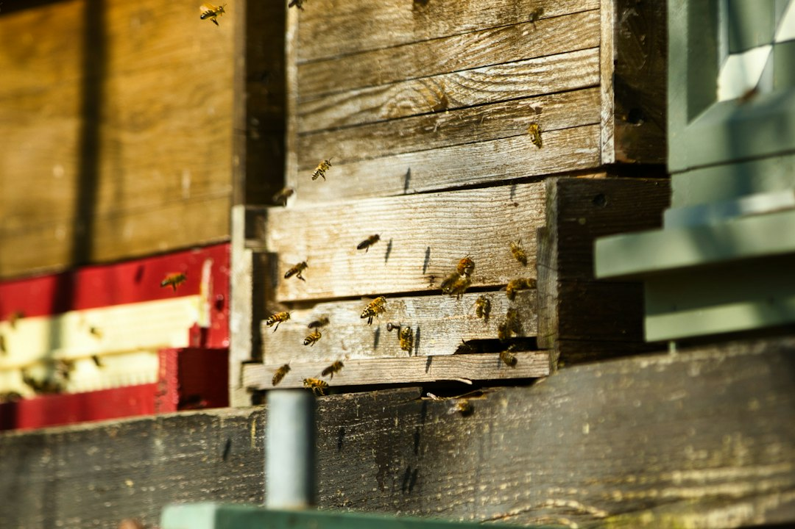

A hive sensor is useful when it helps you ask a better question before your next visit. It can show that conditions changed between inspections, but it cannot tell you everything happening inside a colony. The practical goal is a reliable record that complements frame inspection, pest monitoring, and local seasonal knowledge. Start with the management decision you need to improve, then choose equipment that can provide relevant measurements.

For a backyard apiary, that decision might be whether stores appear to be declining, whether a sensor has stopped reporting, or which colony deserves closer attention when weather allows an inspection. These are different questions. No single temperature, humidity, weight, or sound reading proves a colony is healthy, queenright, diseased, or about to swarm. Monitoring can support observation without providing a diagnosis.

You can begin with a notebook and consistent manual observations before buying connected hardware. If you add sensors, compare the complete setup: logger, power supply, gateway, signal coverage, export options, maintenance, and any subscription. An inexpensive device that cannot safely tolerate its installation environment or retain useful history may cost more effort than it saves. A purpose-built system still needs careful installation and interpretation.

This guide covers every major category of hive monitoring and data logging tools, explains what the readings mean for colony health, walks through a practical setup approach, and identifies the mistakes that cause most beekeepers to abandon their monitoring hardware within a season.

## What Hive Monitoring Data Actually Tells You

A temperature sensor measures its immediate surroundings. The reading can change with sensor position, colony activity, weather, and the way the hive is arranged. Humidity measurements also depend on temperature and location. Read both as part of a record of conditions rather than as a universal colony-health score. When a reading changes, first ask whether the device and its context changed.

Continuous records fill gaps between visits, but interpretation remains important. A change after adding a box or moving a sensor should be annotated before you compare it with earlier data. A sudden gap may indicate a flat battery or lost connection rather than a biological event. Plan how you will verify an alert safely instead of assuming that every notification requires opening the hive immediately.

For a broader look at reading colony condition between hardware-assisted data points, see [Early Warning Signs Your Bee Colony Is In Trouble](/2026/09/19/early-warning-signs-your-bee-colony-is-in-trouble/).

The four core data streams in hive monitoring are:

- **Temperature:** local conditions at the installed sensor
- **Relative humidity:** moisture conditions interpreted alongside temperature and placement
- **Weight:** whole-hive or partial-hive mass, depending on scale design
- **Sound or vibration:** signals that require context and product-specific interpretation

Choose a first measurement around an actual need. Temperature logging may be convenient to trial; weight records may be more relevant if your main question concerns changes in stores. Either way, start on a manageable number of colonies and build a review habit before expanding. A modest setup that you understand is more useful than several dashboards you cannot interpret.

## Temperature and Humidity: The Core Metrics for Hive Monitoring

Before selecting a temperature or humidity logger, read the installation instructions and environmental limits. Check whether the probe or the whole device is intended for in-hive use, whether it records without a phone nearby, and how the battery can be replaced. Verify measurement range, accuracy, history retention, and export capability separately. The presence of an app does not establish that all of those features are included.

A consumer indoor hygrometer is not automatically suitable for installation inside a hive. Condensation, propolis, access by bees, and maintenance may differ from its intended indoor use. This guide does not recommend putting an unverified household device into the colony. Use a device whose documentation supports the intended installation, and avoid modifying a hive simply to accommodate unsuitable hardware.

Placement must follow the specific device instructions. For example, [BroodMinder’s TH and T documentation](https://doc.mybroodminder.com/31_sensors_T_TH/) distinguishes sensor models and installation positions. Record where yours is installed and date any move. Measurements taken above the colony and measurements taken nearer brood should not be compared as though they came from the same location.

Instead of a universal temperature alarm, establish a documented interpretation process:

- Check that the displayed time is current and the device is assigned to the correct hive.
- Compare the reading with recent weather and the same sensor’s history.
- Review recent feeding, inspections, box changes, and sensor moves.
- Follow local bee-health guidance when deciding whether and how to inspect.

Do not infer nosema, chalkbrood, queen status, or treatment needs from humidity alone. An unexpected moisture trend is a reason to check the setup and consider a suitable follow-up, not a diagnosis. Avoid changing ventilation or adding treatments solely to make a dashboard number match an arbitrary target. If signs of disease are present, consult an extension specialist, apiary inspector, or other appropriately qualified local resource.

Connectivity needs a site test. Check whether data remain on the sensor when your phone is absent, whether a gateway is required, and how an outage is displayed. A Wi-Fi gateway still needs usable coverage and power at its location. Test the actual hive position and intended collection route; advertised open-air range does not guarantee communication through walls, vegetation, or hive equipment.

## Hive Weight Scales and Their Role in Data Logging

Weight records can help you track change over time. Check whether a scale measures the complete hive or one side, and whether the displayed figure is measured mass or an estimate. Gross hive weight includes equipment, bees, stores, water, and anything you add. It is not the same as pounds of available honey. Consistent installation and a dated equipment record are essential for interpretation.

Compare readings taken under similar conditions and annotate feeding, harvesting, added supers, rain, and maintenance. [USDA ARS work on datalogger-linked balances](https://www.ars.usda.gov/research/publications/publication/?seqNo115=184506) examined rainfall, seasonal change, swarms, and daily fluctuations. That variety is a useful reminder that a weight curve can have several causes. A fixed daily gain or weekly consumption rate is not a dependable rule for every colony and climate.

A sharp drop deserves investigation, but it does not identify a swarm by itself. First rule out equipment removal, scale movement, a logging fault, or another recorded event. Combine the graph with observations and an inspection plan appropriate to the season. Avoid declaring a colony queenless, starving, or collapsing from a weight signature alone.

Purpose-built scales differ in their installation, capacity, logging, and connectivity. The [BroodMinder-W3 documentation](https://doc.mybroodminder.com/33_sensors_W3_intro/) identifies W3 as a whole-hive scale, not an acoustic module. Use the exact model documentation when comparing devices. Do not assume that products within the same brand share sensors, alert functions, gateways, or subscription requirements.

A household postal or bathroom scale is not an automatic substitute for equipment designed to support a loaded hive outdoors. Capacity, stability, weather exposure, long-term loading, and the ability to record readings all matter. Avoid lifting or balancing a heavy colony on an improvised platform. If you use manual weight observations, choose a safe method suited to your equipment and experience, with local guidance where needed.

## Acoustic Sensors and Vibration Monitors

Sound and vibration add another channel of observation, but interpretation is demanding. A microphone and an accelerometer measure different signals, and a device that records sound is not necessarily a validated queen-status or swarm detector. Treat any automated classification as a prompt to investigate. Ask what the manufacturer has actually demonstrated for the exact model and intended use.

Before buying acoustic equipment, request documentation of the sensor, mounting method, data access, and meaning of each alert. Ask whether the feature is released or experimental, what conditions were used to evaluate it, and how false alerts are handled. A product name that sounds related to “sound” is not evidence of an acoustic capability; W3, for example, is a scale.

Environmental noise, mounting changes, and local conditions can complicate interpretation. Decide in advance how you would confirm a warning and what action would be justified. If the vendor cannot explain the limitation of an alert, it is difficult to build a reliable management process around it. Do not buy on a promise that hardware will replace the need to understand your colony.

For a small apiary, it is reasonable to postpone acoustic monitoring until you can explain what extra decision it would improve. There is no requirement to assemble every sensor category. Review whether your existing records already answer the question, and whether improving your inspection notes or making a regular visit would be more practical.

## Building a Data Logging Setup for the Backyard Apiary

Moving from point-in-time sensor readings to stored trend data is the essential shift that makes monitoring genuinely useful. A current reading tells you what conditions look like right now. Trend data tells you whether conditions are improving, degrading, or stable over time - and that direction is what enables proactive decisions before problems become losses.

Here is a practical six-step approach to building a beginner-to-intermediate hive monitoring and data logging system:

1. **Choose one question and a suitable device.** Write down what you want to learn, the measurement required, and what follow-up you can safely perform. Confirm installation instructions, environment, power, data storage, and connectivity before purchase. Begin with one trial hive if that makes the setup easier to maintain.

2. **Create a baseline with context.** Log readings alongside weather, inspections, feeding, box changes, and sensor position. A baseline is a reference rather than proof that the colony is healthy. Continue normal bee-health checks while you learn the system; do not wait several weeks to investigate a known urgent problem just to complete a data collection period.

3. **Test alerts and data freshness.** Confirm what the app reports when a device stops communicating. Where configurable, choose alerts informed by the device guidance and local conditions. Record a follow-up for each alert, including whether it was a device problem or required a colony check. Refine settings from those records instead of treating generic numbers as biological limits.

4. **Add weight monitoring if it answers a separate question.** Check scale capacity, stability, and installation before placing a hive on it. Annotate additions and removals. Establish local stores targets with an experienced adviser rather than converting gross scale weight directly into available honey or using one overwintering target for every climate.

5. **Export your data to a spreadsheet on a monthly basis.** Sensor apps display recent history reasonably well, but a simple graph of daily weight and temperature changes over a 90-day window gives you perspective that an app scroll cannot match. Multi-season data from the same colonies becomes genuinely useful for identifying whether year-to-year performance is improving or declining.

6. **Review records before the next visit.** Identify stale data, recent changes, and questions worth checking. Prioritize visits with the weather, season, and known colony risks in mind. Stable sensor readings do not justify skipping necessary inspections, mite monitoring, or a response to visible signs of trouble. Finish each review with a concrete next action and a date.

**Hive monitoring tools at a glance:**

| Tool category | What to verify before purchase | Useful question | Main limitation |
|---|---|---|---|
| Temperature/humidity logger | Intended placement, environment, history, export | Did conditions at this sensor change? | Location-dependent; no health diagnosis |
| Hive scale | Capacity, full/partial measurement, stable support | How did mass change after known events? | Equipment and water affect weight |
| Acoustic/vibration device | Exact sensor, evidence for alerts, mounting | Is there a signal worth checking? | Interpretation and false alerts |
| Connected gateway | Coverage, power, recurring fees, outage handling | Can I retrieve fresh readings remotely? | A gateway is not an extra health sensor |

Request a complete quotation for the setup you intend to use, including required accessories and recurring services. Prices and subscriptions change, so compare current manufacturer information rather than relying on a general price bracket. Keep a copy of the model specification and the features included at purchase. This also helps when an app or service changes later.

### A Simple Record Format

Use one row per observation or event, with a stable hive identifier rather than a nickname that changes each season. Include the local date and time, the device identifier, measurement units, sensor position, and whether the value was read manually or exported. Keep your observation separate from your interpretation. For example, a change in the graph is an observation; a suspected swarm is an interpretation until you have supporting evidence.

Record maintenance in the same timeline. Battery replacement, an app update, a gateway outage, moving the hive, or recalibrating a scale can affect how later readings compare. If the sensor has no reliable timestamp after an outage, mark that period uncertain rather than assigning invented times. Preserve the raw export and work on a copy when making graphs or correcting labels. That makes it easier to trace an unusual pattern back to the original record.

### Before You Depend on Remote Readings

Test a normal collection cycle while you can still visit the hive easily. Confirm that the system shows the last measurement time rather than merely the last time you opened the app. Check whether a graph connects points across missing data and makes an outage look like a stable period. Learn the difference between a sensor reading, a gateway upload, and a notification. A working phone notification does not prove the underlying measurement is recent.

Write a short contingency plan for a communications failure. It might involve checking power or batteries at the next safe opportunity, reviewing the last physical observation, and deciding whether a visit is needed. Avoid a plan that depends on dismantling a hive in unsuitable weather simply to repair an optional sensor. Normal colony care should remain possible when the hardware is unavailable.

### Review the Trial Before Expanding

After a useful trial period, list the decisions the system helped you make and the maintenance it required. Include false alerts, missing readings, export limitations, and time spent resolving connection issues. Decide whether the information was relevant, whether you could verify it, and whether you could act on it. If the trial mainly produced interesting graphs without changing a practical decision, keeping the setup small may be the sensible outcome.

When comparing a second device, ask it to answer a new question rather than collecting the same data for its own sake. Make a list of required functions and optional features before reviewing the sales page. Check what remains available if a subscription ends, whether you can retrieve your historical records, and how replacement parts are obtained. Those details can matter more over several seasons than an attractive dashboard on the day of purchase.

## Common Hive Monitoring Mistakes to Avoid

A monitoring setup can fail through poor maintenance or interpretation even when its hardware works. Build the following checks into your routine so the records remain useful. The goal is fewer unsupported assumptions and clearer follow-up, not a dashboard that appears reassuring.

**Buying sensors and never establishing a review habit.** This is the most common outcome. Hardware goes in, the app gets installed, and after a few weeks of glancing at the current reading with no frame of reference, the habit dies. The fix is structural: schedule a five-minute data review at the same time each week, as you would any recurring apiary task. Trend data without a review cadence is hardware sitting idle in a hive.

**Ignoring placement changes.** The right location depends on the device and the question. Record its position and follow the manufacturer’s instructions. If a sensor moves during an inspection, annotate that time and consider whether you need a new baseline. Do not relocate equipment repeatedly just to obtain a preferred number.

**Treating an outlier as a diagnosis.** Check freshness, battery, connectivity, recent equipment changes, and weather first. Persistent trends can also have several explanations. When direct observations suggest an urgent problem, follow appropriate local guidance; do not delay solely because the graph is inconclusive. Conversely, do not treat for disease based only on a sensor alert.

**Missing context during a nectar dearth.** A falling weight trend may justify reviewing stores, but the graph alone cannot distinguish consumption, robbing, equipment changes, and other causes. Note what you observed at the entrance and during appropriate inspections. Make feeding and pest-management decisions from the colony’s actual condition and local guidance.

**Buying more hardware before checking the first setup.** Review whether your existing system has influenced a useful decision. If not, find out why: missing records, unreliable connectivity, unclear interpretation, or a question the measurement cannot answer. Resolve that gap before expanding to more hives or another sensor category.

## Frequently Asked Questions About Hive Monitoring

**Do I really need hive monitoring equipment as a beginner beekeeper?**

No. Good inspection skills, records, appropriate feeding, and pest management remain the foundation. Connected hardware may help if you have a clear question and time to maintain it. Try a simple observation log first, then identify what you cannot learn from it. A sensor purchase is optional and does not guarantee fewer colony losses. Choose a manageable trial rather than assuming every beginner needs a full monitoring system.

**How often should I check hive monitoring data?**

Set a review cadence that fits your season, colony risks, and ability to respond. Check that data are fresh whenever you review them. Use suitable alerts to identify gaps or changes between reviews, but remember that an alert is useful only if you can verify it. Schedule normal inspections and pest monitoring independently; the app should support that plan rather than quietly replacing it.

**Can I use a standard indoor digital thermometer instead of a dedicated hive sensor?**

An indoor device can be useful for learning how logging and exports work in its intended environment. That does not establish that it is safe or durable inside a hive. Check the manufacturer’s installation and environmental guidance. If that evidence is missing, do not recommend it for in-hive use. You can still build a useful manual observation record while evaluating purpose-built equipment.

Monitoring works best as a documented learning loop: observe, check context, verify when appropriate, act, and record the result. Keep uncertainty visible in your notes. Writing “weight fell after rain; cause not confirmed” is more useful than labelling the event a swarm without evidence. Over time, those records help you understand both your colony and the limits of the equipment.

Start with a clear question, one suitable measurement, and a review routine you can keep. Check the exact device documentation and save records outside the app when possible. Expand when the next tool has a defined job. The objective is a practical aid to colony management, with a clear distinction between a measurement, an interpretation, and a confirmed finding.

If this guide was useful, bookmark it for reference before your next inspection season or share it with a new beekeeper in your local club who is considering their first monitoring setup.

## Related Reading

- [Seasonal Beekeeping Calendar: Month by Month Tasks](/2026/05/07/2026-05-07-seasonal-beekeeping-calendar-month-by-month-tasks/)
- [How To Read Your Hives Population Through The Season](/2026/06/12/how-to-read-your-hives-population-through-the-season/)

  
<strong>About the Author</strong>

  
The MB Beekeeping team researches backyard beekeeping practices, drawing on apiary science literature, extension service recommendations, and documented keeper outcomes. Our guides focus on practical hive management decisions that hold up under scrutiny.

