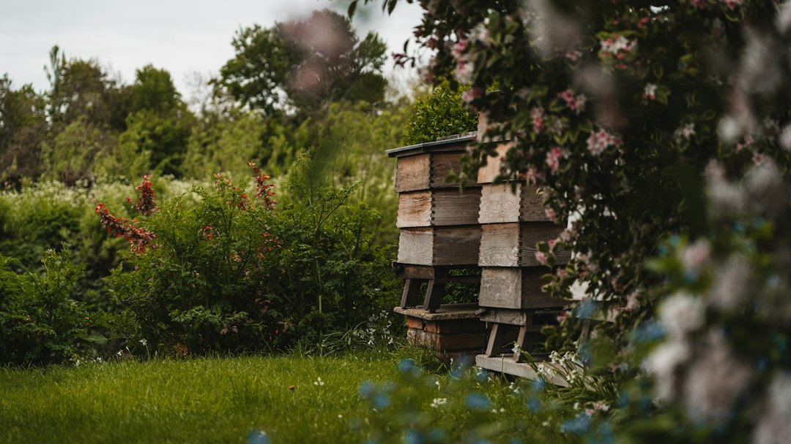

*This post contains affiliate links. As an Amazon Associate, I earn from qualifying purchases at no extra cost to you.*

Most colony losses trace back to a timing problem rather than a skill problem. A keeper adds supers a week too late and the colony swarms. A mite check slips to October and the winter bees are already damaged. A hive gets opened on a cold morning in February and the cluster breaks apart. Bees follow biology and weather, not your free weekends, so your calendar has to follow them.

The position of this guide is simple: run your apiary on a monthly beekeeping schedule built around the colony's brood cycle, then adjust it to your local bloom and frost dates. Do not run it on a fixed date list copied from another region. A keeper in Georgia and a keeper in Minnesota can share the same sequence of tasks, but the months will not line up.

The schedule below assumes a cool-temperate Northern Hemisphere climate with a real winter, which covers most of the United States. If you are in the South, shift the spring and fall work earlier or later by several weeks. If you are in the Southern Hemisphere, flip the calendar by six months.

Photo by [Eric Dekker](https://unsplash.com/@egdekker?utm_source=artlines_blog&utm_medium=referral) on [Unsplash](https://unsplash.com/?utm_source=artlines_blog&utm_medium=referral)

## Your Monthly Beekeeping Schedule at a Glance

Start with the overview, then read the seasonal sections for the reasoning. The table gives the single most important priority for each month and the inspection tasks that support it. Treat the months as anchors and let local conditions move them.

| Month | Main priority | Key inspection tasks |
|---|---|---|
| January | Protect the cluster | Heft hives, clear entrances, no frame inspections |
| February | Stores and early brood | Check emergency feed on mild days, watch for first pollen |
| March | First real inspection | Confirm queen presence, assess stores, reverse boxes if needed |
| April | Buildup | Weekly checks for brood pattern, add space, begin swarm watch |
| May | Swarm control | Inspect every 7-10 days, look for queen cells, split if crowded |
| June | Main flow | Add supers, check for honey space, mite baseline |
| July | Flow and heat | Ventilation, water, supers, inspect every 2 weeks |
| August | Harvest and mites | Pull honey, test for mites, treat if over threshold |
| September | Winter bees | Feed if light, reduce entrances, stop robbing |
| October | Final decisions | Combine weak colonies, wrap or insulate, confirm stores |
| November | Seal up | Mouse guards, ventilation, final heft check |
| December | Broodless window | Optional oxalic treatment, leave colonies alone |

Two rules sit underneath the whole table. First, inspection frequency tracks the colony's growth rate, so you open hives often when they expand quickly and rarely when they do not. Second, every inspection should answer a specific question. If you cannot name the question, wait a week.

Keep notes every time you open a hive. A short log turns a vague impression into a trend line, and [creating and maintaining inspection logs for tracking hive health data](/2026/10/06/creating-and-maintaining-inspection-logs-for-tracking-hive-health-data/) walks through a format that does not take long to fill out.

### Why the brood cycle drives the calendar

A worker bee takes about 21 days from egg to emergence, a queen about 16, and a drone about 24. Those numbers matter because they set your inspection spacing. A swarm cell you miss today is capped within about a week, so a 7-10 day interval in spring is the longest gap that reliably catches queen cells before the colony leaves.

## Winter Priorities: November Through February

Winter is the season where the best action is often restraint. The colony forms a cluster, burns stored honey to hold temperature, and raises very little brood until around the turn of the year. Opening the box releases heat that the cluster needs weeks to rebuild.

**November** is your sealing month. Install mouse guards if you have not already, since mice move into hives as soon as nights cool. Confirm the entrance is open and clear of dead bees, and check that the hive tilts very slightly forward so condensation drains out the front. Moisture, not cold, is what usually kills a colony that has enough food. A top vent or a quilt box that lets damp air escape is worth more than extra wrapping. If you have not already worked through your fall tasks, [how to prepare your apiary for winter](/2026/06/10/how-to-prepare-your-apiary-for-winter/) covers the full setup.

**December and January** are mostly external checks. Do not pull frames if the air temperature is below roughly 50°F (10°C). Instead, hold your ear to the side of the box and listen for a low hum, tilt or heft the back of the hive to estimate remaining stores, and clear snow or debris from the entrance. A hive that feels very light in January is a candidate for emergency feeding with a block of fondant or sugar candy placed directly over the cluster on a mild day.

**February** brings the first signs of change. On a warm afternoon, watch the entrance for pollen coming in and for bees flying. Those are good signs of a queen who has started laying. The danger in this month is starvation, because brood rearing speeds up consumption just as the stores run lowest. Check the weight again and have candy ready.

> **Safety note:** Oxalic acid is a corrosive chemical. If you use it during the December broodless window, follow the product label exactly, wear an appropriate respirator, eye protection, and chemical-resistant gloves, and never use vaporizers indoors or without ventilation. Local regulations and the label govern which products you may use.

The December broodless window is the one exception to the "leave them alone" rule. With little or no brood, mites are exposed on adult bees, which is why many keepers treat then. The [Honey Bee Health Coalition varroa management guide](https://honeybeehealthcoalition.org/varroa/) lays out which treatments suit which conditions and temperatures. If you prefer to avoid synthetic products, see [varroa mite management strategies without chemical treatments](/2026/09/17/varroa-mite-management-strategies-without-chemical-treatments/) for the tradeoffs.

## Spring Priorities: March Through May

Spring is the highest-stakes stretch of the calendar. The colony goes from a few thousand winter bees to tens of thousands of foragers, and your job is to keep up with that growth without letting it turn into a swarm.

**March** is your first full inspection, but only on a calm day with temperatures near 55-60°F (13-16°C) or higher. The goals are narrow: confirm eggs or young larvae (proof of a laying queen), check remaining stores, and note whether the cluster is on the bottom or top box. Do not tear apart the brood nest. If the colony is queenless, you have time to order a replacement, and [where to buy queen bees, what to look for, and how to order](/2026/06/09/where-to-buy-queen-bees-what-to-look-for-and-how-to-order/) explains how to avoid a bad purchase.

**April** is buildup. Inspect weekly or every 10 days. Look for a compact, solid brood pattern, pollen stored around the brood, and nectar starting to arrive. As frames fill, add a box before the colony runs out of laying room. A crowded brood nest is the main trigger for swarming, so adding space early beats reacting later.

**May** is swarm season in most regions. Shorten your interval to 7-10 days and look specifically for queen cells, particularly on the bottom bars of frames. Cups with eggs or larvae in them mean the colony is preparing. At that stage you can still act: make a split, or remove the old queen and let the colony raise a new one. [How to split a hive to prevent swarming](/2026/05/28/how-to-split-a-hive-to-prevent-swarming/) walks through the method, and [managing swarms: prevention, capture, and relocation for small beekeepers](/2026/10/29/managing-swarms-prevention-capture-and-relocation-for-small-beekeepers/) covers what to do if one gets away.

> **Safety note:** Your smoker is a live fire. Keep it on bare ground or a non-flammable surface, never in dry grass or inside a vehicle, and fully extinguish it by plugging the spout and starving it of air. Also know your own sting reaction. If you or anyone nearby has a history of severe allergic reactions, talk to a physician about emergency treatment before opening a hive.

### A repeatable inspection routine

A routine keeps inspections fast and consistent. This sequence works for most spring and summer checks:

1. **Prepare before you open.** Light the smoker, put on your protective gear, and have your hive tool, frame grip, and notebook within reach. Choose a warm, calm, mostly sunny part of the day when foragers are out.
2. **Smoke the entrance lightly, then open.** Give a puff or two at the entrance, wait a minute, lift the cover, and add gentle smoke across the tops of the frames. Too much smoke agitates bees and taints the honey.
3. **Check for the queen's work, not the queen herself.** Pull a frame from the middle of the brood nest and look for eggs, larvae, and capped brood in a tight pattern. Eggs mean the queen was there within three days.
4. **Assess space and stores.** Note how many frames are covered with bees, how much nectar and pollen is stored, and whether the top box is more than about 70 percent full.
5. **Look for problems.** Scan for queen cells, chewed or sunken cappings, spotty brood, deformed wings, and unusual smells.
6. **Close up and record.** Return frames in their original order, close the hive gently, and write down what you saw while it is fresh.

If you are buying gear for these routines, the [31-piece beekeeping starter kit](https://www.amazon.com/dp/B0DWHRVGJM?tag=mbbeekeeping-20) is listed with a bee suit, bee smoker, hive tools, frame holder, frame grip, and bee brush, which covers many of the tools in the sequence above in one purchase. Check the listing for exactly what is included, and compare it against the checklist in [the best beekeeping tools buyer's guide](/2026/06/12/best-beekeeping-tools-buyers-guide/) before deciding.

## Summer Priorities: June Through August

Summer is about managing abundance and then surviving the lean stretch that follows it. The nectar flow peaks, then fades, and the colony's mood changes with it.

**June** is when supers go on. Add a super when the top brood box is mostly full and bees are working the outer frames, and add the next one when the first is about two-thirds drawn. Waiting until the super is full invites congestion and swarming. Take a mite sample now, using an alcohol wash or sugar roll on about 300 bees (roughly half a cup) from a brood frame. This is your baseline, and a commonly cited action threshold is around 2-3 mites per 100 bees, though you should check current guidance for your area. The [Bee Informed Partnership](https://beeinformed.org/) publishes survey data and monitoring resources that help you interpret your numbers.

**July** is hot. Inspect about every two weeks, and focus on ventilation, water access, and super space. Bearding at the entrance on hot evenings is normal. Opening too often during the heat and a strong flow does more damage than good, because bees cap frames fast and each disturbance slows them down.

**August** is the pivot. Most regions see the flow fade, so you must shift from production to protection. Pull finished honey, typically when frames are mostly capped, and leave the colony with enough stores. After harvest, run another mite test, because populations climb quickly in late summer as brood declines and mites concentrate on fewer cells. If the count is over your threshold, treat promptly with a method suited to the temperature and the products on your label, since the bees raised in the next few weeks are the winter bees. [Varroa mite management: natural and chemical treatment options](/2026/09/24/varroa-mite-management-natural-and-chemical-treatment-options/) compares your options.

Harvest planning belongs here too. [Understanding honey extraction: when and how to harvest](/2026/06/02/understanding-honey-extraction-when-and-how-to-harvest/) covers timing and moisture checks, so you do not bottle honey that will ferment.

As the flow tapers, defensive behavior and robbing rise. For a day when hives are testy, a full-body suit gives more coverage than a jacket. The [Goodland Bee Supply GLFS2-L full body suit](https://www.amazon.com/dp/B0FHBN94NR?tag=mbbeekeeping-20) is listed with a space hat and veil, which can suit keepers who want head and neck protection, though you should check the sizing chart and reviews for fit.

## Fall Priorities: September and October

Fall is where the year is won or lost. The colony you carry into winter is raised in the final weeks of warm weather, and the decisions you make now determine whether it survives.

**September** is stores and entrances. Heft each hive, or open it and count frames of honey. Many cold-climate keepers aim for roughly 60 pounds of stored honey going into winter, though the right number depends on your region and colony size, so use local extension or club guidance as your reference. If a colony is light, feed 2:1 sugar syrup while nights are still warm enough for the bees to cure it. Reduce the entrance with an entrance reducer, which helps the colony defend itself against wasps and robbers. For detail, see [identifying and stopping honeybee robbing before it spreads](/2026/10/24/identifying-and-stopping-honeybee-robbing-before-it-spreads/) and [protecting hives from wasps, hornets, and backyard predators](/2026/09/15/protecting-hives-from-wasps-hornets-and-backyard-predators/).

**October** is decision time. Do a final inspection on a warm day. You are looking for a laying queen or at least fresh brood, enough bees to cover about six to eight frames, and adequate stores. A weak colony rarely survives, and combining it with a stronger neighbor usually beats watching both fail. The newspaper method is the standard technique, and [combining weak colonies for winter: the timeline and best practices](/2026/10/17/combining-weak-colonies-for-winter-the-timeline-and-best-practices/) explains the process in detail.

Wrap up the remaining tasks now: remove any queen excluders so the cluster can move freely, install a mouse guard, tilt the hive slightly forward, and add insulation or a windbreak if you live where winters are severe. If you are still assembling equipment, a standalone option like the [stainless steel smoker kit with heat shield](https://www.amazon.com/dp/B0DWJPWQWS?tag=mbbeekeeping-20) is a straightforward replacement if your current smoker is worn out, and you will want one ready before spring anyway.

## Common Mistakes That Break a Monthly Beekeeping Schedule

A schedule only helps if you avoid the errors that undermine it. These are the problems that show up most often in extension guidance and keeper reports.

**Inspecting on a fixed day instead of for a reason.** Opening every hive every Saturday regardless of weather or colony status wastes time and stresses the bees. Tie each inspection to a question: queen present, space available, swarm cells, stores adequate.

**Waiting too long in spring.** The most common swarm cause is overcrowding. If you check a hive only every three weeks in May, you will miss the queen cell window. Stay at 7-10 days until the colony settles.

**Skipping mite counts.** Many keepers treat on a calendar date without ever sampling, or never treat at all. Both are guesses. Sample in spring, early summer, and after harvest, and act on the numbers.

**Treating at the wrong time.** Some treatments only work in certain temperature ranges or when honey supers are off. Read the label before you start, and remove supers when it requires.

**Harvesting too much.** Pulling every capped frame in August can leave the colony without enough stores. Your fall feeding then becomes a rescue rather than a supplement.

**Feeding too late.** Syrup fed in cold weather often goes uncured and raises moisture inside the hive. Do the feeding while the bees can still process it.

**Opening in cold or wet weather.** Chilling brood and breaking the winter cluster cause damage that no later care fixes. When in doubt, wait.

**Ignoring local conditions.** A schedule copied from another climate will be wrong by weeks. Use bloom dates, frost dates, and a local beekeeping club as your calibration.

If you notice early trouble, [early warning signs your bee colony is in trouble](/2026/09/19/early-warning-signs-your-bee-colony-is-in-trouble/) is a good reference for deciding when to intervene.

## Frequently Asked Questions

### How often should I inspect my hives during the active season?

During spring buildup and swarm season, inspect every 7-10 days, because that interval is short enough to catch queen cells before they are capped. In midsummer, once the colony has plenty of space and the flow is steady, every two weeks is usually enough. In fall, limit yourself to one or two purposeful checks for stores, queen status, and mites. In winter, avoid opening the hive entirely and rely on external checks like hefting and entrance monitoring. The goal is not a fixed number of visits but enough information to make timely decisions without disturbing the colony more than necessary.

### Should I open my hive in winter?

Generally no. Frame inspections below roughly 50°F (10°C) break the cluster and can chill brood once the queen starts laying. Instead, check from the outside: listen for a hum, heft the hive to judge weight, make sure the entrance is clear of dead bees and snow, and watch for cleansing flights on warmer days. The main exception is emergency feeding, where you place fondant or candy over the cluster on a mild afternoon if the hive feels very light. Do it quickly, and close the hive as soon as the food is in place.

### When should I test for varroa mites?

Test at least three times a year: once in spring to establish a baseline, once in early summer before the main flow ends, and once in August or early September after you remove honey supers. The late-summer test matters most because mite numbers rise as brood declines, and the bees raised in fall must carry the colony through winter. Use an alcohol wash or sugar roll on about 300 bees, then compare the result to a recognized threshold such as 2-3 mites per 100 bees. Retest after treatment to confirm that it worked.

### What equipment do I need to follow a full-year schedule?

At minimum, you need protective gear, a smoker, a hive tool, and a frame grip or holder. Beyond that, plan for extra boxes and frames for spring expansion, mouse guards and entrance reducers for fall, a mite-testing jar or kit, and feeding supplies. Bundled kits such as the [31-piece beekeeping starter kit](https://www.amazon.com/dp/B0DWHRVGJM?tag=mbbeekeeping-20) can cover the basics in one purchase, and you can add specialty items as your apiary grows. Inspect all gear before each season so a worn smoker or cracked veil does not cause a problem mid-inspection.

### Build Your Schedule This Week

Pick a hive, open your notebook, and write down the next three months of tasks using the table above as a starting point. Then adjust each month to your own frost dates and bloom times, ideally with input from a local beekeeping club. Put mite tests and swarm-season checks on your calendar first, because they are the two jobs most often missed. Gear up before you need it: a working smoker, a veil that fits, and spare boxes ready in April. A schedule that you actually follow will protect your colonies better than any single clever technique.

Bookmark this page and check back each month for a quick refresher on what the bees need next.

### Related Reading

- [How To Prepare Your Apiary For Winter](/2026/06/10/how-to-prepare-your-apiary-for-winter/)
- [Creating And Maintaining Inspection Logs For Tracking Hive Health Data](/2026/10/06/creating-and-maintaining-inspection-logs-for-tracking-hive-health-data/)

  
<strong>About the Author</strong>

  
The MB Beekeeping team researches backyard beekeeping practices, drawing on apiary science literature, extension service recommendations, and documented keeper outcomes. Our guides focus on practical hive management decisions that hold up under scrutiny.

