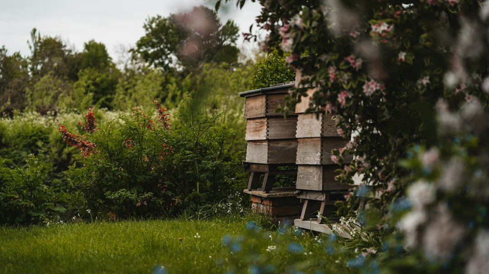

*This post contains affiliate links. As an Amazon Associate, I earn from qualifying purchases at no extra cost to you.*

Buying packages and nucs gets expensive fast, and the bees you pay for are rarely adapted to your local weather. A split lets you turn one thriving colony into two or three using bees that already know your forage, your winters, and your yard. For most hobbyists, creating colonies from splits is the cheapest and most dependable way to expand an apiary. It also doubles as one of the best swarm prevention tools you have.

The catch is that splits fail for predictable reasons. The parent colony was too weak, the timing missed drone season, the new queen never returned from her mating flight, or the beekeeper moved the wrong frames. None of these problems are mysterious. They are planning problems, and November is the right time to plan, because hives are quiet and equipment is easy to assemble before the rush.

This guide takes a clear position. Make splits in late spring from your strongest colonies, keep them small enough to hold heat, and check for eggs on a fixed schedule. Below you will find readiness benchmarks, an equipment list, a method comparison, numbered steps, a first-30-days timeline, and a troubleshooting section.

Photo by <a href="https://unsplash.com/@egdekker?utm_source=artlines_blog&utm_medium=referral">Eric Dekker</a> on <a href="https://unsplash.com/?utm_source=artlines_blog&utm_medium=referral">Unsplash</a>

## Why Creating Colonies From Splits Works

A healthy colony is a self-contained factory for the three things you would otherwise buy: workers, brood, and a queen. Divide those assets sensibly and the bees do most of the work. A queen at peak season often lays 1,000 or more eggs a day, so a colony that gives up part of its brood and bees in spring can rebuild quickly, provided the split is made while the season still has weeks of growth ahead.

The cost advantage is real. Prices for packages and nucs vary by region and rise when spring supply tightens, while a split requires only a box, some frames, and optionally a purchased queen. You also skip the shipping stress and the unknown genetics that come with bees from distant suppliers.

Local adaptation is the quieter benefit. Bees that have already overwintered in your area carry traits that matter: temperament, cluster behavior, and how they cope with your forage gaps. Splitting from your best colonies is a form of selection. Splitting from a defensive or chronically weak hive simply multiplies the problem, so use a colony with a calm temperament and a solid brood pattern. If you are unsure how to judge that, [Assessing Queen Quality Through Brood Pattern Analysis](/2026/11/05/assessing-queen-quality-through-brood-pattern-analysis/) walks through what to look for.

Splitting also relieves congestion, which is the main swarm trigger. A split made before swarm cells appear is one of the most effective ways to keep bees in your yard, though it is not a guarantee. Once swarm cells are capped, you are managing a different problem, and [Managing Swarms: Prevention, Capture, and Relocation for Small Beekeepers](/2026/10/29/managing-swarms-prevention-capture-and-relocation-for-small-beekeepers/) covers that.

The main tradeoff is honey. Splitting during a nectar flow diverts bees from foraging, so the parent colony will produce less surplus. If your priority is a honey crop from one hive this year, split only the colonies that are clearly ahead. If your priority is increase, accept a smaller harvest and treat the bees as your crop.

## Timing, Strength, and Equipment Before You Split

### When to split

Splits belong in the window after colonies are building fast and before the main flow ends. In much of the northern hemisphere that means roughly mid-spring to early summer, when drones are flying and the weather supports mating flights. In November, a northern beekeeper's job is planning and building equipment, not splitting. Cold-climate winter splits produce clusters too small to survive, and virgin queens cannot mate without warm weather and drones.

If you keep bees in the southern hemisphere or in a mild climate with year-round forage, anchor your timing to drone presence and nectar flow rather than the calendar. Capped drone brood in the parent colony and drones visible on the frames are the signals that local mating conditions are building.

### Is the colony strong enough?

A practical benchmark is a colony with bees covering most frames of two deep boxes, at least six frames of brood in mixed stages, fresh eggs, and some stored honey and pollen. A colony that is merely average should be left alone this year. Weak parents produce weak splits, and weak splits are the ones that get robbed.

Check for disease before you move any comb. Do not move frames from a colony with suspected foulbrood or a heavy mite load. If anything looks off, review [How To Identify And Treat American Foulbrood](/2026/09/22/how-to-identify-and-treat-american-foulbrood/) and sort out the problem first.

### Equipment checklist

For small splits, a five-frame box holds heat better than a half-empty ten-frame deep. The [Pro Nuc 5 Frame Plastic Nuc Box with Locking Lid](https://www.amazon.com/dp/B0C6MJVZ6F?tag=mbbeekeeping-20) fits that role, and the locking lid is useful if you plan to carry splits to a second yard. Check the listing to confirm the box takes the frame size you run.

You will also need frames to fill gaps. A set like the [MayBee 10 Pack Beehive Frames with Wax Foundations for Deep Box](https://www.amazon.com/dp/B08ZRZ7PGJ?tag=mbbeekeeping-20) gives you wooden deep frames with wax-coated foundation, so the split has somewhere to build while the queen establishes. Frame dimensions vary slightly by manufacturer, so confirm compatibility with your existing equipment and check what assembly is required.

If you buy a mated queen, a reusable cage helps. The [RyanDesign 6-Pack Plastic Queen Bee Cage](https://www.amazon.com/dp/B0FDQXY8D5?tag=mbbeekeeping-20) can hold a queen safely while you work, isolate her briefly, or serve as an introduction cage. Check whether the design needs a candy plug or a separate closure, and follow your queen supplier's instructions for release. For sourcing, see [Where To Buy Queen Bees: What To Look For And How To Order](/2026/06/27/where-to-buy-queen-bees-what-to-look-for-and-how-to-order/).

Add the basics: smoker, hive tool, bee brush, a feeder, an entrance reducer, a robber screen, and a marker or notebook.

**Safety note:** Work in full protective gear, keep smoke handy, and know how you and anyone nearby react to stings. If a household member has a known venom allergy, have an emergency plan and seek immediate medical care for any serious reaction.

## Choosing a Split Method

The method you choose determines your timeline, cost, and risk. Each of the four common approaches below solves a different problem.

| Method | Queen source | Time to a laying queen | Best for | Main risk |
|---|---|---|---|---|
| Walkaway split | Bees raise an emergency queen from young larvae | About 4 to 5 weeks | Tight budgets, strong local stock | Queen lost on mating flight; long brood gap |
| Queen-introduced split | Purchased mated queen | Often laying within days of release | Fast growth, genetic upgrade | Rejection at introduction; queen cost |
| Queen cell split | Ripe cell or virgin from a chosen colony | About 3 to 4 weeks | Propagating your best stock | Damaged cell; mating failure |
| Five-frame nuc split | Any method above | Depends on method | Small increments, overwintering | Needs transfer to a full box later |

The table hides the most important variable, which is risk tolerance. Every method that depends on a virgin queen mating carries a failure rate from weather, predators, or a thin drone population. Methods using a purchased mated queen avoid that gap, which is why they are the better default for beginners.

The recommendation here: for your first splits, use a queen-introduced split into a five-frame nuc. You pay for the queen, but you skip weeks of uncertainty and you start with documented genetics. Once you have a colony you want to reproduce, move to walkaway or queen cell splits.

If you want a deeper treatment of small colonies specifically, [How To Make Nucleus Colonies](/2026/07/25/how-to-make-nucleus-colonies/) covers the nuc-building process in more detail.

## Step by Step: Creating Colonies From Splits

This sequence works for a queen-introduced split. Notes for walkaway splits appear where the process differs.

1. **Prepare the receiving box.** Assemble frames and set up the nuc or deep box on its new stand before you open the parent. Have a feeder, entrance reducer, and robber screen within reach.

2. **Open the parent colony on a warm, calm day.** Mid-morning to early afternoon with foragers flying is ideal. Smoke lightly and work frame by frame to find the queen. Set her frame in a safe spot, or move her to a cage while you work.

3. **Select frames for the split.** Take two or three frames of brood with eggs and young larvae, plus one or two frames of honey and pollen. Brush or gently shake nurse bees from one or two extra brood frames into the new box, since nurses stay with brood while foragers return to the original spot.

4. **Keep the queen in the parent.** In a standard queenright split, confirm she is still in the original box before you close up. If you cannot find her, put the selected frames in the new box and check both boxes the next day for eggs. The box without eggs is queenless and will raise a queen from the young larvae it holds.

5. **Fill the gaps and arrange frames.** Place brood in the center, food at the edges, and fill remaining space with drawn comb or foundation frames. A tight box is easier for the bees to heat and defend.

6. **Handle the queen.** For a walkaway split, close the box and let the bees raise a queen. For a purchased queen, wait about 24 hours so the split recognizes it is queenless, remove any queen cells started, and hang the caged queen between brood frames. Follow the supplier's instructions for release, which is commonly several days after introduction.

7. **Reduce the entrance and move the split if possible.** Foragers drift back to the original location, so a new yard about 2 to 3 miles away works best. If you must keep the split in the same yard, face the entrance in a different direction and stuff grass in the opening for a day.

8. **Feed and stay out.** Offer 1:1 sugar syrup if forage is thin. Then leave the split alone except for scheduled checks, which are covered in the next section.

## The First 30 Days After the Split

The first month decides whether the split becomes a colony. Keep disturbances minimal and check on a schedule.

**Days 1 to 2:** Confirm the bees are calm and clustering on brood. Watch for robbing at the entrance. If guard bees are fighting at the door, shrink the opening and add a robber screen.

**Days 5 to 7 (walkaway):** Look for queen cells, then close up quickly. Capped cells by about day 8 or 9 from the original egg are a good sign. **Days 3 to 5 (introduced queen):** Check that workers are not balling or biting the cage. If they are calm, release her according to the supplier's instructions.

**Days 10 to 14:** For walkaway splits, avoid opening the box. A virgin queen emerging, hardening, and taking mating flights is easily disturbed, and a startled queen can be lost. For introduced queens, confirm she is out of the cage and laying.

**Day 21 to 28:** For queen cell splits, check for eggs and young larvae. For walkaway splits, plan on about four weeks before you see eggs, and sometimes five. If you see no eggs by about day 35, you likely have a failed mating and need to act.

**Day 30 and beyond:** Expand into more frames once bees cover most of the box. [Nuc Box Vs Full Size Hive: When To Transfer And What Equipment You Need](/2026/08/20/nuc-box-vs-full-size-hive-when-to-transfer-and-what-equipment-you-need/) explains when to transfer.

**Mite control:** A split is a useful moment for varroa management because brood breaks expose mites on adult bees. Extension and Honey Bee Health Coalition guidance generally recommend monitoring mite loads before and after splitting, and using registered treatments strictly per label. See the [Honey Bee Health Coalition](https://honeybeehealthcoalition.org/) for current control guidance and [Penn State Extension](https://extension.psu.edu/) for regional beekeeping resources.

If a new colony struggles, [What To Do When A New Bee Nuc Is Weak: The First 30 Days](/2026/08/18/what-to-do-when-a-new-bee-nuc-is-weak-the-first-30-days/) is a good diagnostic starting point. Record every check in your log; [Creating And Maintaining Inspection Logs For Tracking Hive Health Data](/2026/10/06/creating-and-maintaining-inspection-logs-for-tracking-hive-health-data/) has a workable format.

## Common Mistakes That Sink New Splits

**Splitting a weak colony.** If the parent barely covers a few frames, a split costs you two weak hives. Wait until the colony is clearly outgrowing its space.

**Splitting too early or too late.** Early splits risk chilling brood and poor mating weather. Late splits leave too little time to build stores and population before winter. Anchor your timing to drones and forage.

**Moving the queen by accident.** In a queenright split, always confirm which box has her. When in doubt, check for eggs after 24 hours.

**Keeping the split too close to the parent.** Foragers return to their old location, leaving the split with too few bees to defend itself. Move it far, or use the entrance tactics in step 7.

**Releasing the queen too soon.** A queen released into a split that is not ready may be balled and killed. Keep her caged until workers are calm, and remove emergency cells before introduction.

**Ignoring robbing.** Small splits with big entrances invite robbing. Reduce the opening, avoid spilled syrup, and consider a robber screen. [Identifying And Stopping Honeybee Robbing Before It Spreads](/2026/10/24/identifying-and-stopping-honeybee-robbing-before-it-spreads/) explains how to read the early signs.

**Disturbing a virgin queen.** Opening a walkaway split between emergence and mating risks losing the queen. Resist the urge.

**Skipping mite checks.** Moving brood moves mites. Test before you split and again afterward.

**Failing to keep records.** Without dates, you will not know whether a queen is late or lost. Write down split dates, queen status, and every inspection.

## Frequently Asked Questions

### How many splits can I make from one colony?

A strong colony in spring can usually support one or two splits, depending on size and when the main flow begins. A single split leaves the parent strong enough to produce honey. Two or three smaller splits maximize increase but sacrifice crop and require more feeding and monitoring. Newer beekeepers should start with one split per strong colony, evaluate how it performs after 30 days, and only then try more. If you run only one hive, the safest path is a single five-frame split so you retain a healthy parent. Splitting a colony into small pieces without enough bees to cover brood is the fastest way to lose all of them.

### Do I need to buy a queen to make a split?

No. A walkaway split lets the bees raise their own queen from eggs or young larvae, which costs nothing and preserves local genetics. The tradeoff is time and risk: the queen must emerge, mate, and return, and many weeks pass before eggs appear. Buying a mated queen shortens that gap and lets you upgrade stock, but it costs money and introduction can fail. If you are building your first extra colony and cannot afford a failed attempt, a purchased queen is the safer choice. If you have strong colonies and some budget flexibility, try walkaway splits alongside purchased queens to compare results.

### What if my split never gets a laying queen?

If you see no eggs by about five weeks, the queen likely failed to mate or was lost. Check for laying workers, which produce scattered drone brood and multiple eggs per cell. If the split has a few remaining frames of brood, you can give it a frame of eggs and young larvae from a strong colony so it can try raising another queen, or introduce a purchased mated queen. If the bees are very few, combining them with a stronger colony is often the best use of those bees. [Combining Weak Colonies For Winter: The Timeline And Best Practices](/2026/10/17/combining-weak-colonies-for-winter-the-timeline-and-best-practices/) covers the technique.

### Can I overwinter a split?

Yes, if it builds enough population and stores. A split made in late spring or early summer has time to grow into a full colony by fall. One made late in the season may not. Look for a laying queen, good brood patterns, and enough honey and pollen going into cold weather. Many beekeepers overwinter small nucs successfully, but they need sufficient bees to hold heat and enough food. Local extension guidance on winter preparation is worth reading, and [How To Prepare Your Apiary For Winter](/2026/06/10/how-to-prepare-your-apiary-for-winter/) covers feeding, ventilation, and entrance management for new colonies.

## Your Next Move

Creating colonies from splits is a skill you build once and use every year. This winter, pick the one or two colonies you would most like to reproduce and note why: temperament, brood pattern, winter survival, mite tolerance. Assemble your frames and boxes now so spring finds you ready, order a queen if you plan to use one, and write your split dates into a calendar tied to drone presence in your area. Start with one well-planned five-frame split rather than several rushed ones, then use your records to improve each year.

Bookmark this guide for spring, and leave a comment with the split method you plan to try first.

### Related Reading
- [How To Make Nucleus Colonies](/2026/07/25/how-to-make-nucleus-colonies/)
- [Re Queening Your Hive: Timing, Methods, And Selecting The Right Replacement Queen](/2026/10/01/re-queening-your-hive-timing-methods-and-selecting-the-right-replacement-queen/)

  
<strong>About the Author</strong>

  
The MB Beekeeping team researches backyard beekeeping practices, drawing on apiary science literature, extension service recommendations, and documented keeper outcomes. Our guides focus on practical hive management decisions that hold up under scrutiny.

