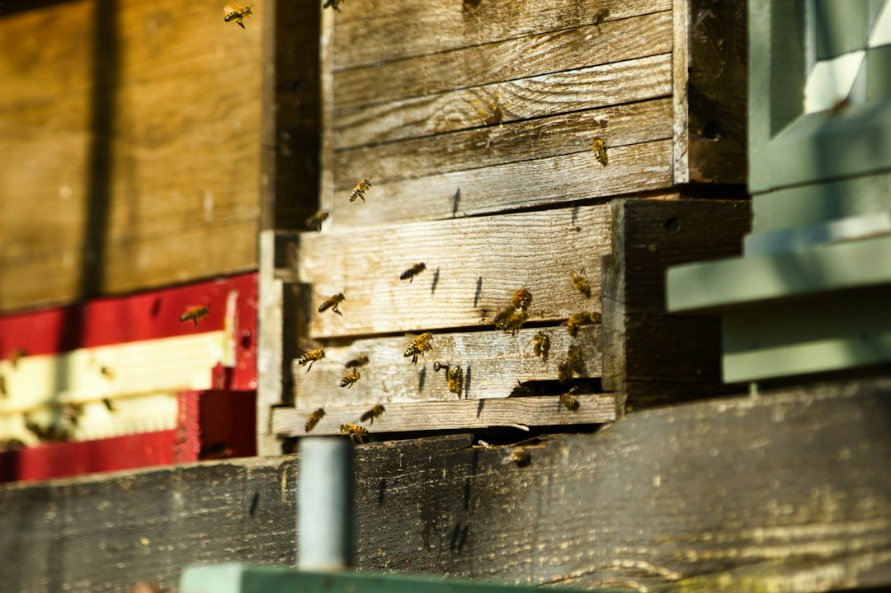

*This post contains affiliate links. As an Amazon Associate, I earn from qualifying purchases at no extra cost to you.*

Most backyard beekeepers do not need a motorized radial extractor. If your hives give you somewhere between 20 and 80 pounds of surplus honey in a good year, spending hundreds of dollars on a big machine can cost more than the honey is worth for the first several seasons. The better question is how to get honey out of comb cleanly, with little waste, little equipment, and no moisture or contamination problems.

The practical answer for one to three hives is a short ladder. Start with crush and strain if you have no spare drawn comb and only a few frames to process. Move to a manual two-frame extractor, owned or borrowed, once you want to reuse comb. Pair either route with a double-sieve strainer and food-grade containers, because filtering and bottling matter as much as how the honey leaves the frame. Skip improvised heating, power drills on homemade drums, and anything that cannot be fully washed.

This guide compares the cheapest workable options, walks through preparation and bottling, and flags the errors that cost small producers the most honey.

Photo by <a href="https://unsplash.com/@paws_and_prints?utm_source=artlines_blog&utm_medium=referral">𝕡𝕒𝕨𝕤 𝕒𝕟𝕕 𝕡𝕣𝕚𝕟𝕥𝕤</a> on <a href="https://unsplash.com/?utm_source=artlines_blog&utm_medium=referral">Unsplash</a>

## Low Cost Extraction Methods for Small Batch Honey Production: The Real Tradeoffs

"Low cost" has three parts: what you pay up front, how much honey you lose, and what the method costs your bees. Beginners tend to count only the first. Drawn comb is the hidden currency. Bees build wax by consuming honey, and commonly cited estimates run to several pounds of honey consumed for each pound of wax produced. A method that destroys comb saves money on equipment and then quietly spends it back in the next nectar flow.

That is why the cheapest option on paper is not always the cheapest across a season. Crush and strain costs almost nothing, but every frame you crush has to be rebuilt. A manual extractor costs more up front, yet it returns intact frames that the bees refill faster. For a keeper with a single hive and no extra drawn comb, crushing a frame or two may still make sense. For anyone expecting to harvest again next year, comb preservation usually wins.

The table below lays out the main options for small batches.

| Method | Upfront cost | Keeps comb? | Best for | Main drawback |
|---|---|---|---|---|
| Crush and strain | Lowest | No | One or two frames, first harvest | Bees must rebuild comb |
| Gravity drain | Low | Partly | A few frames in a warm room | Slow and incomplete yield |
| Cut comb | Low | Yes, sold as comb | Premium comb honey | Needs suitable frames and packaging |
| Small 2-frame extractor | Moderate | Yes | Several frames per session, repeat harvests | Storage space and cleaning time |
| Borrowed club extractor | Very low | Yes | Occasional harvests | Scheduling and sanitation |

My recommendation for most small producers is a manual extractor if you plan to keep bees for more than a season, and a borrowed one if you are still deciding. Our [guide to honey extractors for small scale beekeepers](/2026/06/23/best-honey-extractors-for-small-scale-beekeepers/) covers larger models if you outgrow this setup.

## Prepare Frames and Workspace Before You Extract

Good prep prevents most extraction problems, and it costs nothing. Honey flows best when it is warm, so work in a room that stays comfortably warm, around the low 90s Fahrenheit if you can manage it, and never heat honey beyond what you would call mildly warm. Overheating degrades flavor and aroma, and it adds nothing to a small batch.

Check the honey itself before you pull frames. The USDA's honey grading standards set a maximum moisture level of 18.6 percent for the top grades, and honey well above that is more likely to ferment in storage. Frames that are fully or almost fully capped are the safest bet. If many cells are uncapped, test with a refractometer, a small and inexpensive tool, or leave the frames on the hive longer. You can review the [USDA honey grades and standards](https://www.ams.usda.gov/grades-standards/honey-grades-and-standards) to see how moisture figures into grading.

Here is a simple preparation sequence that works for any of the methods in this guide.

1. Remove capped frames from the hive and clear the bees with a brush or bee escape, then carry the frames in a covered box so robbers and wasps cannot reach them.
2. Set up a clean, enclosed workspace such as a kitchen, garage, or spare room, and close windows to prevent bees from following the scent.
3. Lay out food-grade buckets, a clean uncapping tool, and a tray to catch wax cappings.
4. Uncap each frame with a heated knife, a serrated bread knife, or an uncapping fork, working from the bottom up and letting cappings fall into the tray.
5. Process the frames right away while the honey is still warm from the hive.

A serrated bread knife dipped in hot water and wiped dry works well and is already in most kitchens. An uncapping fork is a cheap alternative for patchy or uneven capping. Keep cappings, because the honey that clings to them can be drained into your final batch and the wax can be rendered later.

If robbing is a concern during your harvest window, see our post on [identifying and stopping honeybee robbing](/2026/10/24/identifying-and-stopping-honeybee-robbing-before-it-spreads/) before you leave frames or buckets exposed.

## Crush and Strain Versus Gravity Drain: Two Low Cost Extraction Methods Without Machinery

If you want a method that needs no extractor at all, you have two realistic options.

### Crush and Strain

This is the oldest approach and still the most accessible. You cut the comb from the frame, crush it in a clean food-grade bucket with a potato masher or clean hands in gloves, and let the honey drain through a strainer into a second bucket. The honey separates from the wax over several hours, helped by room warmth.

The advantages are obvious. You need a bucket, a masher, and a strainer. There is no cleaning of spinning parts, and you can process a single frame the moment you pull it. For a first harvest from a new colony with barely any surplus, this is a reasonable way to taste your results without a purchase.

The disadvantage is the lost comb. If you use foundationless frames or wax foundation, the bees will have to build everything again, which slows the colony and consumes honey. Some keepers deliberately run a few frames for crush and strain each year as a form of comb renewal, rotating old dark comb out. That is a smart use of the method: crush the oldest frames, and extract the rest.

### Gravity Drain

Gravity drain is a slower cousin. You uncap a frame, rest it at an angle over a screen or strainer in a bucket, and wait. In a warm room, honey will slowly run out of the open cells, and flipping the frame partway helps. Expect a lot of waiting and incomplete results, because thick honey clings to the comb, and cooler rooms make it worse.

I would not recommend gravity drain as a primary method unless you have a single frame and plenty of time. It is useful for finishing leftover frames, or for draining wet cappings, but it cannot match the speed of an extractor.

### Cut Comb as a Third Path

If you want to avoid extracting entirely, cut comb is an option. You cut finished comb from thin foundation or foundationless frames, fit pieces into clear containers, and sell or share them as comb honey. It needs the least equipment of all, although it also needs frames designed for it, and its yield per frame is lower than extraction. It makes sense for gifts and premium sales, less so for volume.

## Budget Extractors and Shared Equipment

An extractor spins frames so centrifugal force throws honey out of the cells onto the drum wall, leaving the comb intact. For small batches, a hand-crank model is enough. A two-frame unit handles a pair of frames at a time, which is slow compared with commercial equipment but perfectly workable for a few hives.

The [Mann Lake HH130 2-Frame Plastic Extractor](https://www.amazon.com/dp/B00B8L5YWE?tag=mbbeekeeping-20) fits this category as a two-frame plastic extractor. Before you buy any small extractor, check the listing for which frame depths it accepts. Compact units are often designed around medium or shallow frames, and deep frames may not fit or may need to be handled differently. Confirm that against the box sizes you actually run. Plastic construction also means you should use warm, not hot, water for cleanup and avoid scraping the drum with metal tools.

A typical workflow with a small manual extractor looks like this: load two uncapped frames, spin slowly at first to pull out the honey from the first face without blowing out the comb, flip the frames, spin the other face, then flip again and finish the first side at a higher speed. Spinning too fast too early can break fragile new comb, especially in warm conditions, so patience matters more than muscle.

### Borrowing or Sharing First

Before spending anything, check whether a local beekeeping association lends or rents equipment. Many clubs keep a shared extractor and sometimes a bottling bucket and uncapping tools. A borrowed extractor teaches you whether you like the process, how many frames you realistically produce, and which features matter. The tradeoff is scheduling and sanitation. Clean any shared equipment carefully before and after use, and arrange your harvest around availability rather than perfect timing.

### When to Buy

Buy your own extractor when you expect to harvest every year, when borrowing delays your harvest beyond the right moment, or when you want to process frames on your own schedule. If you plan to scale toward sales, read our overview of [starting a honey business and the regulations you need](/2026/10/04/starting-a-honey-business-what-regulations-and-licenses-you-need/) before deciding, because licensing and kitchen rules can change what equipment makes sense.

## Strain, Settle, and Bottle Small Batches

Extraction gets honey out of the comb. Filtering and bottling determine whether it looks and keeps well. Small producers often rush this stage and end up with wax flecks, foam, and bubbles in the jar.

A two-stage strainer is the simplest fix. A coarse mesh removes the larger wax pieces and bee parts, and a finer mesh catches smaller debris. The [BEEKNOWS stainless steel double sieve honey strainer](https://www.amazon.com/dp/B0DWMDCTFV?tag=mbbeekeeping-20) is listed for use with 5-gallon bucket honey, which suits the common practice of draining extractor output straight into a food-grade bucket through a sieve. Avoid cloth or fine nylon filters for thick honey unless you are willing to wait, because they clog and tempt you to apply heat or pressure.

After straining, let honey settle in a covered, food-grade bucket for 24 to 48 hours. Bubbles and fine wax rise to the surface, and you can skim them off before bottling. Use a bucket with a honey gate near the bottom if you have one, because it lets you fill jars from beneath the foam without stirring it back in.

Choose containers that suit how you sell or give your honey. The [Little Giant glass skep jar 12 pack in 32 ounce size](https://www.amazon.com/dp/B00PX955TY?tag=mbbeekeeping-20) is listed with airtight lids, which is the kind of closure you want for glass. As a rough guide, honey weighs about 12 pounds per gallon, so a 32 ounce container holds around three pounds when filled near the top. Leave a little headspace and check the listing and your jar for the actual fill line.

Wash and fully dry every jar before use. Water left in a jar raises local moisture and can encourage fermentation at the surface. Label jars with your name and the harvest date. If you plan to give or sell honey beyond friends and family, read the FDA's [guidance on proper labeling of honey and honey products](https://www.fda.gov/regulatory-information/search-fda-guidance-documents/guidance-industry-proper-labeling-honey-and-honey-products), and check your state's cottage food or honey rules. Our post on [how to store and preserve honey at home](/2026/06/20/how-to-store-and-preserve-honey-at-home/) covers the longer-term side.

## Common Extraction Mistakes and Problems to Avoid

Most failed small harvests come from a handful of repeat errors. Here are the ones that cost the most.

**Extracting uncured honey.** Pulling frames with large uncapped areas risks high moisture and fermentation. Wait for capping, or test moisture before you commit. If you have to extract partly capped frames, keep that honey separate and use it first.

**Using the wrong containers.** Honey is acidic and can react with some metals. Stick to food-grade plastic, glass, or stainless steel. Do not store honey in galvanized or aluminum containers.

**Skipping the cleanliness checks.** Residual water, old wax, and dust in a bucket or jar all end up in the honey. Clean and dry everything before the harvest starts, not during it.

**Spinning too hard, too soon.** Fast speeds on a heavy frame can blow out the comb. Start slow, flip, and increase speed gradually.

**Overheating honey.** Heating honey to make it flow faster, especially with direct heat, damages flavor and can scorch it. Warm the room, not the honey.

**Ignoring robbing pressure.** Open frames, sticky floors, and wet equipment left outdoors attract robbers and wasps, which can turn a good harvest into a defensive-hive problem. Work indoors and clean up promptly.

**Taking too much.** Leaving the colony without enough stores for winter is a bigger loss than any equipment decision. Our guide on [preparing your apiary for winter](/2026/06/10/how-to-prepare-your-apiary-for-winter/) explains how to judge what to leave on the hive.

If honey will not drain or flow, the cause is usually temperature. Move the work to a warmer space before you add heat to the honey itself.

## FAQ

### What is the cheapest way to extract honey from a single hive?

For a single hive with little spare comb, crush and strain is the cheapest method because it needs only a food-grade bucket, a masher, and a strainer. You cut the comb from the frame, crush it, and let the honey drain through the strainer over several hours in a warm room. The tradeoff is that your bees must rebuild the destroyed comb, which costs them honey and time. If you expect to harvest again, borrowing a club extractor for the first season is usually a better value, because it preserves comb and costs little beyond cleaning time.

### Can I use a drill to spin a homemade extractor?

Many homemade designs exist, but they carry real risks, including unbalanced loads, loose frames, contaminated materials, and parts that are difficult to clean. A small manual extractor designed for food contact removes those problems at a moderate price, and borrowing one from a club removes them entirely. If you do build something yourself, use only food-safe materials, keep speeds low, and make sure every surface that touches honey can be scrubbed and dried. For most hobbyists, the safer and simpler route is to buy or borrow a purpose-built unit rather than improvise one.

### How long should honey settle before bottling?

Plan on 24 to 48 hours in a covered, food-grade bucket in a warm room. This gives air bubbles and fine wax time to rise to the surface, where you can skim them off before filling jars. Settling longer is fine as long as the container is sealed against moisture and pests, but crystallization can begin sooner in cooler spaces and with some floral sources. If you want clear jars for gifts or sale, strain through a coarse and fine sieve first, let the honey rest, and then fill jars slowly from a gate near the bottom to avoid trapping new bubbles.

## Conclusion

For small batch honey production, the best low cost approach is usually a staged one. Crush and strain a frame or two if you have no spare comb, borrow a club extractor for your first full harvest, and buy a manual two-frame unit once you know you will harvest every year. Put money into filtering and clean containers before you put it into bigger machinery, because those details decide how the finished honey looks and keeps.

Your next step is practical: check your frames for capping, call your local beekeeping association about equipment loans, and set up a clean, warm workspace before harvest day.

If this guide helped, bookmark it for harvest season or leave a comment with the method you plan to try.

**Related reading**

- [Understanding Honey Extraction: When and How to Harvest](/2026/06/02/understanding-honey-extraction-when-and-how-to-harvest/)
- [How to Store and Preserve Honey at Home](/2026/06/20/how-to-store-and-preserve-honey-at-home/)

  
<strong>About the Author</strong>

  
The MB Beekeeping team researches backyard beekeeping practices, drawing on apiary science literature, extension service recommendations, and documented keeper outcomes. Our guides focus on practical hive management decisions that hold up under scrutiny.

