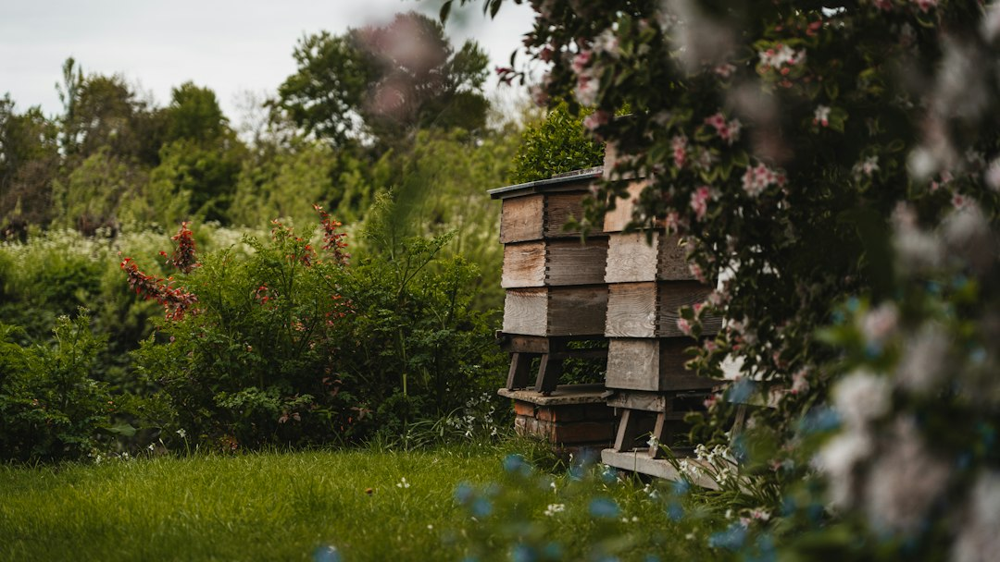

*This post contains affiliate links. As an Amazon Associate, I earn from qualifying purchases at no extra cost to you.*

A colony that goes into winter light does not fail in November. It fails in February, when the cluster runs out of reachable stores and cannot break away to get food a few inches to the side. By then your options are narrow and mostly bad. Fall feeding is the cheapest insurance in beekeeping, yet it is the step most often done late, mixed at the wrong ratio, or done with no target weight in mind.

This guide takes a firm position: feed to a number, not to a calendar date. Know how many pounds of stores your region's winter demands, measure what each colony holds, and close the gap with 2:1 syrup while the weather still lets bees process it. Everything else, from feeder choice to protein supplements, either helps you hit that number or distracts from it.

It also covers a situation many keepers face in mid-November: a colony still short on stores after the syrup window has closed. Fondant and sugar bricks can still rescue a light hive. Strong spring colonies are built in the fall, and the decisions below separate a hive that explodes in March from one you are mourning.

Photo by <a href="https://unsplash.com/@egdekker?utm_source=artlines_blog&utm_medium=referral">Eric Dekker</a> on <a href="https://unsplash.com/?utm_source=artlines_blog&utm_medium=referral">Unsplash</a>

## Why fall feeding decides winter survival

Honey bees do not hibernate. A winter cluster rotates bees between the cold outer shell and the warmer core, burning stored carbohydrate to generate heat. Once brood rearing restarts in late winter, consumption climbs sharply, because a brood nest held near 93 F in freezing weather needs a lot of fuel. That is why many colonies with plenty of food in December starve in late winter: the first warm days trigger brood rearing and consumption well before forage exists.

Fall feeding solves three separate problems.

**Total mass of stores.** A colony needs enough capped carbohydrate to last until reliable nectar flows, not just until the first warm spell.

**Placement of stores.** Bees need food directly above and beside the cluster. A hive can weigh enough overall yet still starve if the stores sit in outer frames while the cluster is stuck on empty comb. Syrup stored in the fall usually lands close to the brood nest, an advantage over late patchy nectar.

**Quality of the bees themselves.** Long-lived winter bees are raised roughly from late summer through early fall. Colonies that are protein-starved or heavily infested with varroa during that window produce weaker winter bees, and no amount of sugar fixes that later. Feeding supports winter bee production, but it cannot replace mite control. If your counts are not under control, read our guide to [varroa mite management natural and chemical treatment options](/2026/09/24/varroa-mite-management-natural-and-chemical-treatment-options/) before you pour a single gallon of syrup. Sugar fed to a colony collapsing from viruses is wasted.

Fall feeding is not a rescue step for hives you neglected. It is the final stage of a sequence: control mites, confirm a healthy queen, then top off stores so the colony enters winter with margin.

## Set your fall feeding targets by weight and climate

Start with a number. Guidance varies by region, so confirm yours with a local beekeeping association or your state extension service. As a rough frame, milder southern climates can overwinter on somewhere around 40 to 60 lb of stored honey, while long, cold northern winters commonly call for 70 to 90 lb or more in a standard multi-box colony. Treat those as orientation points, not rules. The [Bee Informed Partnership](https://beeinformed.org/) publishes survey-based research on colony losses and management practices that helps explain regional risk.

Next, measure what you have. Three methods work:

- **Frame count by inspection.** A fully capped deep frame holds roughly 6 to 8 lb of honey, and a medium holds roughly 4 to 5 lb. Count mostly full frames, then add partial frames at a discount.
- **Hefting.** Tip the back of the hive upward from behind. It takes practice and works best as a comparison between colonies in the same yard. The heaviest hive sets your baseline.
- **A hive scale.** If you keep more than a few colonies, a scale gives repeatable numbers. Our roundup of [hive monitoring equipment and data logging tools for backyard beekeepers](/2026/11/07/best-hive-monitoring-equipment-and-data-logging-tools-for-backyard-beekeepers/) covers options, though a simple platform scale is enough here.

Then do the subtraction. If a double-deep colony in a cold region should carry 80 lb and you count about 45 lb, the gap is about 35 lb. Because bees lose some sugar to water evaporation and consumption during processing, a reasonable planning rule is roughly a pound of sugar for each pound of stored feed. To add 35 lb, plan on about 35 lb of dry sugar, which is about 5 gallons of 2:1 syrup. Treat that as approximate and re-weigh as you go.

Also decide which colonies deserve the investment. A strong colony with a good queen and a modest gap is an easy yes. A weak, queenless, or heavily diseased colony is a poor bet for syrup. The timeline and method for merging are covered in [combining weak colonies for winter](/2026/10/17/combining-weak-colonies-for-winter-the-timeline-and-best-practices/), and combining a marginal colony into a strong one often beats feeding it into shape.

## The fall feeding timeline: ratios, steps, and late-season options

The sequence matters as much as the ratio. This protocol works for most backyard operations in temperate climates.

1. **Finish mite control first.** Sample for varroa in late summer, treat if counts exceed your threshold, and confirm the treatment worked. Winter bees are being raised now, and mite pressure during that window shortens their lives.
2. **Weigh and count stores.** Write the numbers in your inspection log. If you are not already tracking this, [creating and maintaining inspection logs for tracking hive health data](/2026/10/06/creating-and-maintaining-inspection-logs-for-tracking-hive-health-data/) is worth the time, since next year's targets come from this year's records.
3. **Calculate the gap and the sugar you need.** Subtract current stores from your regional target and round up slightly.
4. **Reduce entrances and prepare the feeder.** Narrow the entrance to limit robbing, and keep spills off the ground and out of the apiary.
5. **Mix 2:1 syrup.** That is two parts white granulated sugar to one part water by weight, for example 10 lb of sugar dissolved in about 2.5 quarts of hot water. Use warm or hot water, never boiling or scorching it, and let the syrup cool before feeding.
6. **Feed in the evening.** Dusk feeding reduces robbing pressure. Refill when the feeder is empty, not on a fixed calendar.
7. **Reassess every one to two weeks.** Re-weigh, check that bees are storing syrup near the brood nest, and stop when the target is reached or bees stop taking it.

Use only plain white granulated sugar. Do not use brown sugar, raw sugar, powdered sugar with anti-caking additives, or honey of unknown origin. Outside honey can carry spores that spread American foulbrood.

### Match the feed to the temperature

Bees need warm enough weather to fan off moisture and cure syrup. As a general guide, syrup works best while daytime highs sit consistently above about 50 F (10 C). Below that, uptake slows, and unripened syrup can leave excess moisture in the hive.

| Feed type | Best weather window | Best use | Main limitation |
|---|---|---|---|
| 1:1 syrup | Warm weather, spring or early fall | Stimulating comb building and brood | Too thin for winter stores; adds more moisture to process |
| 2:1 syrup | Daytime highs above roughly 50 F | Building winter stores quickly | Needs time and warmth to cure; robbing risk |
| Fondant or sugar brick | Cold weather, any time during winter | Emergency or insurance feed placed directly above the cluster | Slower to deliver bulk weight; limited volume |
| Dry sugar (mountain camp method) | Cold weather, as a last resort | Rescue feeding when syrup is no longer possible | Bees need water access; best treated as a temporary measure |
| Pollen substitute or patties | Late summer to early fall | Supporting winter bee production | Not a carbohydrate source; limited value in deep cold |

### If you are already short in mid-November

If daytime highs have dropped below the syrup range and a colony is still light, shift to solid feeds. Place fondant or a sugar brick directly over the cluster, under the inner cover, using a spacer rim or shim to create room. In a cold snap the bees will not break cluster to reach food on the far side of the box, so placement over the cluster is the whole point. Check emergency feeders on the next warm day rather than opening the hive repeatedly. Solid feed is insurance against late-winter starvation, not a replacement for adequate fall stores, so if a colony is badly underweight, consider combining it with a stronger neighbor.

## Choosing a feeder for fall feeding

Feeder design affects how fast you can deliver sugar, how much disturbance the colony tolerates, and how likely you are to trigger robbing. Common options include entrance feeders, frame feeders, in-hive pail feeders, and top feeders. For a fall protocol that must deliver tens of pounds of syrup in a few weeks, high-capacity top feeders are the most practical choice for most backyard keepers.

The [Mann Lake Top Hive Feeder with Unpainted Wood Super](https://www.amazon.com/dp/B0CV326PX4?tag=mbbeekeeping-20) fits that role. According to the listing, it combines a single-piece plastic reservoir described as leakproof, a galvanized steel safety screen, and a deep, high-capacity design that sits on top of the hive. Three features matter for fall feeding. A top feeder sits above the cluster, so bees can reach syrup without leaving the warm area as nights cool. The safety screen reduces drowning, a real cost with open-pool feeders. And a high-capacity reservoir lets you deliver more syrup at once, so you open the hive less often, which means less heat loss and disturbance while the colony settles in.

Check these points before you buy:

- **Box size.** Confirm the feeder matches 8-frame or 10-frame equipment. A mismatched footprint creates gaps that invite robbing and drafts.
- **Capacity.** Verify the stated capacity on the listing against your sugar plan. If you need 5 gallons of syrup per colony, a larger reservoir saves trips.
- **Stacking height.** A feeder with its own super adds height. Make sure your outer cover or telescoping lid still closes, and plan for extra insulation or a spacer if needed.
- **Cleaning.** Plastic reservoirs are easier to rinse. Clean the feeder between fills to prevent mold and fermentation.

For smaller options for splits and nucs, see our post on [best nuc boxes and feeders for starting or splitting colonies](/2026/08/22/best-nuc-boxes-and-feeders-for-starting-or-splitting-colonies/). For full-size colonies the tradeoff is simple: an entrance feeder is cheap but invites robbing, while an in-hive or top feeder costs more but stays protected inside the box.

One safety note: syrup spills, drips, and the smell of fresh syrup draw wasps and neighboring colonies quickly in the fall dearth. If robbing starts, stop feeding, reduce the entrance further, and follow the steps in [identifying and stopping honeybee robbing before it spreads](/2026/10/24/identifying-and-stopping-honeybee-robbing-before-it-spreads/).

## Protein and stimulants: what helps and what is mostly marketing

Carbohydrate is the winter survival story. Protein is the winter bee story. They are different jobs, and mixing them up wastes money.

### Pollen substitute in late summer and early fall

Winter bees are raised while pollen is still arriving. In a good fall flow, bees collect all the protein they need. In a poor fall, or a region with an early dearth, brood rearing can stall and the colony enters winter with fewer, weaker winter bees. A protein supplement can bridge that gap, but only while the weather is warm enough for the colony to rear brood and take the feed.

The [Mann Lake Ultra Bee Pollen Substitute](https://www.amazon.com/dp/B00B8L5TX8?tag=mbbeekeeping-20) is described as a high-protein dry feed with added vitamins and amino acids and no animal by-products, sold in a 10 lb size. Dry substitutes can be offered in a feeder pan or mixed into patties. The main tradeoff is timing. Feed it too late and the colony will not rear brood in response, leaving you with unused patties and possibly attracted pests. Feed it while brood rearing is active and pollen is short, and it can support the winter bee cohort.

A practical rule: if your colony is bringing in pollen on warm days and has solid brood coverage, skip the supplement. If you see sparse brood and little pollen coming in during late summer, a supplement is reasonable support. Our companion piece on [pollen and protein feeding strategies for year-round colony development](/2026/10/08/pollen-and-protein-feeding-strategies-for-year-round-colony-development/) goes deeper on seasonal protein planning.

### Feeding stimulants

[Honey B Healthy Original](https://www.amazon.com/dp/B07QTCQ52P?tag=mbbeekeeping-20) is a feeding stimulant containing essential oils, sold in a 16 oz bottle. Keepers add small amounts to syrup to encourage uptake. The evidence base for stimulants is thinner than the marketing suggests. If a healthy colony in warm weather is already draining a feeder in a few days, a stimulant adds cost without changing the outcome.

Where a stimulant might earn its place:

- **Slow takers.** A colony that hesitates on fresh 2:1 syrup in early fall may start sooner with a little stimulant, though the better fix is often warmth and a narrower entrance.
- **Syrup that sits for days.** Syrup can ferment or mold in the feeder, but smaller batches and clean feeders matter more than additives.
- **Robbing risk.** Essential oils add scent, which is unwelcome during robbing. Use the minimum or skip it.

Follow the label for dosage, and do not treat a stimulant as a substitute for good timing, clean equipment, and a healthy queen. If you are unsure whether a colony is healthy enough to benefit, check [early warning signs your bee colony is in trouble](/2026/09/19/early-warning-signs-your-bee-colony-is-in-trouble/) first.

## Common fall feeding mistakes to avoid

Most fall feeding failures trace back to a short list of repeatable errors.

**Starting too late.** Syrup feeding in October or November works only in warm regions. In cold climates, bees cannot cure and cap the syrup, and it can leave excess moisture in the hive. Finish syrup feeding while daytime highs are still above roughly 50 F. If you missed the window, switch to fondant or sugar bricks instead of forcing syrup.

**Feeding the wrong ratio.** Using 1:1 syrup for winter stores forces bees to evaporate much more water, costing energy and time. Use 2:1 by weight for fall stores and reserve 1:1 for spring stimulation or comb building.

**Ignoring mites.** If varroa pressure is high, the winter bees will be short-lived and the colony may collapse regardless of how heavy it is. Control mites first.

**Feeding without a target.** Free-pouring syrup until the feeder stops emptying can leave an overfilled brood nest. Bees can backfill brood space with syrup, which limits queen laying and shrinks the winter bee population. Feed to your target weight and watch brood space.

**Spilling syrup and inviting robbers.** Open feeding, sloppy pours, and wide entrances can start a robbing event within hours. Pour carefully, feed at dusk, and reduce entrances.

**Using the wrong sugar or sources.** Stick with plain white granulated sugar. Avoid honey from unknown sources, which can carry foulbrood spores. If you have concerns about disease, see [how to identify and treat American foulbrood](/2026/09/22/how-to-identify-and-treat-american-foulbrood/).

**Skipping ventilation and insulation.** Heavy feeding adds moisture. Provide an upper entrance or a ventilation shim, and keep the hive dry. Condensation dripping onto the cluster kills more bees than cold alone.

**Never rechecking.** A single feeding and a closed lid is not a protocol. Re-weigh, adjust, and confirm the bees took the syrup and stored it where they can reach it.

## Fall feeding FAQ

### When should I stop feeding syrup in the fall?

Stop when your colony reaches its target weight or when daytime highs stay below roughly 50 F, whichever comes first. Bees take syrup slowly in cool weather, and unprocessed syrup can leave moisture in the hive. If a colony is still light after the syrup window closes, switch to fondant or sugar bricks over the cluster rather than continuing liquid feed. Ask your regional beekeeping association or state extension office about the typical cutoff in your area, and keep records so next year's plan starts from real numbers.

### How much sugar does a colony need for winter?

It depends on your climate, colony size, and existing stores. Many cold-climate regions cite targets around 70 to 90 lb of stored feed for a multi-box colony, while milder regions need less. Weigh or count your frames, subtract that from your regional target, and plan to feed roughly a pound of sugar for each pound of stored feed you want to add. Confirm numbers with local experienced keepers or extension guidance, because winter length and the timing of the first spring flow change the answer significantly.

### Is 1:1 or 2:1 syrup better in the fall?

Use 2:1 by weight for fall stores. The thicker syrup contains less water, so bees spend less energy evaporating and capping it, and it stores more carbohydrate per trip. Reserve 1:1 for spring, when you want to stimulate brood rearing and comb building and the weather supports quick processing. If a colony refuses 2:1, check temperature, entrance size, and robbing pressure before changing the recipe.

### Do I need to feed pollen substitute in the fall?

Not every colony does. If your bees are bringing in pollen and have solid brood coverage, skip it. If forage has dried up in late summer or early fall and brood is shrinking, a protein supplement can help support winter bee production, but only while the colony is still rearing brood and the weather is warm enough to take the feed. Late in the season, protein does little and may attract pests. Focus on stores weight and mite control first.

## Conclusion

Fall feeding works when it follows a plan: control mites first, set a regional target for stores, measure what each colony holds, and close the gap with 2:1 syrup while the weather allows. A high-capacity top feeder makes delivery efficient, protein is a limited-window tool, and stimulants are optional extras. If the syrup window has closed and a colony is still light, shift to fondant or sugar bricks over the cluster right away.

Your next action is simple. This week, heft or weigh every colony, write down the numbers, and sort hives into three groups: fine, needs solid feed now, and candidates for combining. Then put those numbers in your inspection log so next fall's plan starts from data.

If this guide helped, bookmark it for next August when the feeding window opens, or leave a comment with your region and winter stores target so other keepers can compare.

**Related reading**

- [Spring Buildup Strategies Feeding And Brood Pattern Optimization](/2026/11/03/spring-buildup-strategies-feeding-and-brood-pattern-optimization/)
- [Pollen And Protein Feeding Strategies For Year Round Colony Development](/2026/10/08/pollen-and-protein-feeding-strategies-for-year-round-colony-development/)

For additional research on colony health, the [Honey Bee Health Coalition](https://honeybeehealthcoalition.org/) offers best-management guidance on mites, nutrition, and disease that complements the feeding plan above.

  
<strong>About the Author</strong>

  
The MB Beekeeping team researches backyard beekeeping practices, drawing on apiary science literature, extension service recommendations, and documented keeper outcomes. Our guides focus on practical hive management decisions that hold up under scrutiny.

