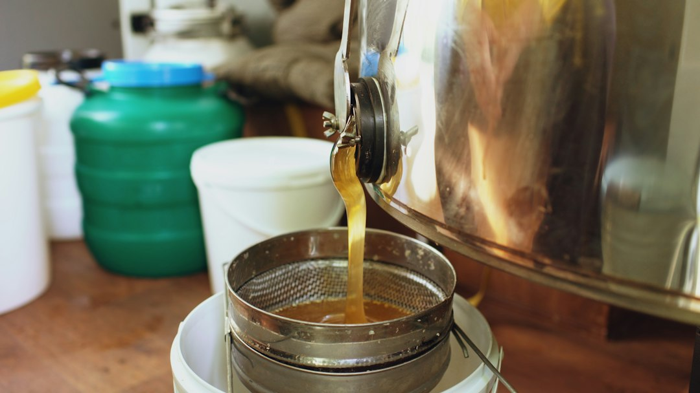

*This post contains affiliate links. As an Amazon Associate, I earn from qualifying purchases at no extra cost to you.*

Most backyard beekeepers do not need a stainless steel radial extractor the size of a washing machine. If you run one to four hives and pull a few supers a year, capacity is not your problem. Your problem is a harvest day that turns into a sticky ordeal because the gear is mismatched, the honey is too thick to move, or filtering was an afterthought. The position here is simple: buy a small extractor, a proper uncapping tool, and a two-stage strainer, then spend the rest of your budget on food-grade buckets and a refractometer. That setup handles roughly 4 to 12 frames per session without taking over your kitchen or garage.

This guide covers the equipment that matters, a repeatable method, and the mistakes that ruin batches. It draws on extension guidance, manufacturer specifications, and common apiary practice rather than a pitch for the biggest machine. By the end you will know what to buy, in what order, and how to run a harvest from supers off the hive to jars on the shelf.

Photo by <a href="https://unsplash.com/@silverkblack?utm_source=artlines_blog&utm_medium=referral">Vitaly Gariev</a> on <a href="https://unsplash.com/?utm_source=artlines_blog&utm_medium=referral">Unsplash</a>

## What Small Batch Honey Extraction Actually Requires

Small batch honey extraction means working in loads of a few frames at a time, usually in a kitchen, garage, or spare room. The core task never changes: open the wax cappings, spin or drain the honey out of the cells, strain out wax and debris, and store the honey before it absorbs moisture. Everything you buy should serve one of those four jobs.

The minimum kit has five pieces:

- **An extractor** sized to your frames, even if it only holds two at a time.
- **An uncapping tool**, such as a knife, fork, or scratcher, plus a tub or tray to catch cappings.
- **A strainer or filter** that fits over a bucket.
- **Food-grade buckets**, ideally with a honey gate (a spigot) near the bottom of the settling bucket.
- **A way to check moisture**, which means a honey refractometer.

That last item is the one beginners skip. Capped honey is usually ripe, but frames that are only partly capped can carry too much water. USDA grading standards for extracted honey set a moisture limit of 18.6 percent for the top grades, and honey above roughly that level is at higher risk of fermenting in storage. A refractometer costs far less than a ruined bucket.

You also need a workspace plan. Honey drips everywhere, and bees will find any open window. Choose a room you can close off, cover the floor with a plastic drop cloth or cardboard, and keep a sink or wash bucket within reach. Work when the honey is warm. Honey at around 90 to 95 degrees Fahrenheit flows far better than honey at 65, and a warm room is the cheapest "equipment" you can use. A closed room with a small space heater set well away from the honey does more for your extraction than any gadget.

Finally, decide how many supers you plan to pull. If you expect one or two supers from a single hive, a hand-crank two-frame machine is plenty. If you expect to grow toward ten supers across several hives, read the comparison in [Best Honey Extractors For Small Scale Beekeepers](/2026/06/23/best-honey-extractors-for-small-scale-beekeepers/) before committing, because a larger extractor changes your buying math.

## Essential Equipment and Technique

### Choosing an Extractor for Small Batch Honey Extraction

For a hobby apiary, the [Mann Lake HH130 2-Frame Plastic Extractor](https://www.amazon.com/dp/B00B8L5YWE?tag=mbbeekeeping-20) is the type of machine that fits the job. Two-frame extractors are typically tangential designs. You load two frames, spin them to empty one face, flip them, and spin again. That extra flip step is the tradeoff against larger radial machines, which empty both sides of every frame at once.

Why favor a small plastic unit over a bigger stainless one? Three reasons.

**Cost and storage.** A compact plastic extractor is often a more modest purchase than a full-size stainless model and takes up less storage space. If you harvest once or twice a year, a machine that sits idle in a corner for ten months should not eat a big share of your budget.

**Cleanup.** A smaller drum means fewer surfaces to rinse. Plastic tubs can be washed in a utility sink, which matters when your extraction room is also your laundry room.

**Gentle handling.** A hand crank gives you direct control over speed. New, heavy, or fragile comb can blow out if you spin too hard on the first pass. Starting slow and ramping up protects the comb, and you can reuse drawn comb next season, which saves the bees enormous energy.

There are real limits. A two-frame machine means more loads per super. A ten-frame medium super takes five rounds, each with a flip, so plan on a couple of hours for a single super with setup and cleanup. If that sounds tedious, consider a larger or motorized unit, or look at a shared or rented extractor from a local bee club. Many clubs lend equipment to members, and that can be the smartest first step.

Before you buy any extractor, check three compatibility points on the product listing: the frame sizes it accepts (deep, medium, or shallow), whether it needs a stand or bolts to a bucket, and whether it has a drain gate you can place a bucket under. Mismatched frame height is the most common reason a new extractor is returned. Measure your frames and compare them with the manufacturer's stated dimensions rather than assuming a "standard" fit.

### Uncapping Tools and Technique for Small Batches

Uncapping is where most of the mess and most of the injuries happen. You are slicing a thin layer of wax off dense comb with a sharp tool while your hands are slippery with honey. Take your time here.

**Safety first.** Use a stable surface, keep your cutting hand moving away from your body, and never reach across the blade. Wear cut-resistant or snug nitrile gloves if you are not confident. If you use a heated electric knife, keep the cord away from honey and water, plug it into a GFCI-protected outlet, and never leave it on a surface where it can scorch. Wet floors and extension cords are a poor combination, so route cords overhead or along a wall.

For most backyard setups, a cold serrated knife is the practical choice. The [Harvest Lane Honey ANG/Cold Knife](https://www.amazon.com/dp/B013H8QU78?tag=mbbeekeeping-20) is a serrated uncapping tool in this category. Its appeal is simple: no cord, no heating element, no warm-up time, and no risk of overheating the honey in the cells. Serrated blades saw through cappings with a gentle back-and-forth motion, which works well on uneven comb where a flat blade tends to skip.

The tradeoff is speed and cleanliness. A cold knife tends to tear cappings slightly more than a hot knife slices them, and sticky honey can gum up the serrations. Keep a jar of warm water nearby and dip the blade between frames. Wipe, then continue.

Here is a technique that works for most frames:

- Rest the frame on an uncapping tub or a bar across a bucket, with the top bar angled slightly toward you.
- Start at the bottom corner and saw upward in short strokes, keeping the blade flat against the frame's wooden edges as a guide.
- Take off only the wax, not the cell walls. A shallow cut leaves comb intact.
- Flip the frame and repeat on the other side.
- Use a capping scratcher or uncapping fork for low spots the knife missed.

Let cappings drain in a colander or a bucket with a mesh insert. That honey is still good, and a surprising amount collects over a day. Do not toss it. Cappings wax is also valuable for candles, balms, and lip products, so rinse it lightly with cool water only after the honey has drained, and let it dry.

One more tip: uncap over the same container you plan to use for the final collection. Fewer transfers mean fewer drips.

### Straining, Settling, and Bottling Your Honey

Extraction gets the honey out of the comb. Straining and settling get it into a form worth selling or gifting. Skipping this stage leaves wax flecks, bee parts, and tiny air bubbles in your jars, and those make honey look cloudy and crystallize unevenly.

A two-stage approach is the sweet spot. The [BEEKNOWS Stainless Steel Honey Strainer](https://www.amazon.com/dp/B0DWMDCTFV?tag=mbbeekeeping-20) is described as a double-sieve design made for a five-gallon bucket. A coarse top screen catches large wax pieces and a finer lower screen catches smaller debris. Stainless mesh is easy to rinse, resists corrosion, and does not hold flavors the way some cloth filters can. If you extract into a bucket and pour through the strainer into a second bucket, you can do the whole job in one pass.

Practical details that matter:

- **Warm honey filters faster.** Cold honey will clog a fine mesh and tempt you to push it through with a spoon, which forces debris through the screen.
- **Do not overheat.** Gentle warmth helps, but heating honey much above the temperatures of a hot hive risks degrading flavor and enzyme activity. Keep it comfortably warm, not hot.
- **Check mesh size against your goals.** A finer filter yields clearer honey but filters slowly. Raw honey sold at farmers markets typically keeps some pollen and tiny wax particles, so avoid ultra-fine filtration if that is your selling point.

After straining, let the honey settle in a covered bucket for 24 to 48 hours. Foam and tiny bubbles rise to the top and can be skimmed off with a spoon. Then draw honey from the bottom gate into clean, dry jars. Glass jars with tight lids are the safest choice, since honey absorbs moisture from humid air.

If you plan to sell, check labeling requirements early. The FDA publishes [guidance on proper labeling of honey and honey products](https://www.fda.gov/regulatory-information/search-fda-guidance-documents/guidance-industry-proper-labeling-honey-and-honey-products), and state cottage food or honey rules vary. Our post on [how to store and preserve honey at home](/2026/06/20/how-to-store-and-preserve-honey-at-home/) covers container choice and crystallization in more detail. The National Honey Board's [honey information resources](https://honey.com/) are also a useful reference for consumer-facing questions about honey types and storage.

## A Step-by-Step Small Batch Honey Extraction Method

This sequence assumes you have already removed supers from the hive with bees cleared off. Our guide on [when and how to harvest honey](/2026/06/02/understanding-honey-extraction-when-and-how-to-harvest/) covers that stage. From here, follow these steps in order.

1. **Prepare the room.** Cover the floor, close windows, and bring the room to a warm temperature. Sanitize buckets, the strainer, the knife, and the extractor with hot water and a food-safe cleaner, then rinse and dry thoroughly. Water left behind is moisture you do not want in your honey.
2. **Check ripeness.** Pick a few frames from different supers and test a drop of honey with a refractometer. If readings are higher than about 18 percent, hold those frames back, let them dry in a warm room with a dehumidifier and fan, and retest later.
3. **Uncap the first set of frames.** Work over a tub, removing the wax cap from both sides. Handle frames by the top bar and keep them upright to avoid dripping.
4. **Load the extractor.** Place two frames in the baskets with the top bars oriented as the manufacturer instructs. Balance matters. Frames of unequal weight make the machine wobble, so pair frames of similar fullness.
5. **Spin the first side slowly.** Start at a low speed for the first minute, then increase gradually. Many tangential designs work best when you empty roughly half of each face on the first pass, flip, then empty the second side fully, and finally return to the first side.
6. **Flip and spin again.** Reverse the frames, spin the second face, then flip once more for a final pass if needed.
7. **Drain and strain.** Open the gate and let honey run through the strainer into a settling bucket. Repeat steps 3 through 6 until the supers are done.
8. **Settle, skim, and bottle.** Cover the bucket for a day or two, skim the surface, and fill jars from the bottom gate.
9. **Return wet frames to the hive.** Place extracted supers back on the hives in the evening so the bees can clean them up. Some beekeepers use them as a mild robbing risk reminder; see [identifying and stopping honeybee robbing before it spreads](/2026/10/24/identifying-and-stopping-honeybee-robbing-before-it-spreads/) if neighbors' colonies are strong.

For a single medium super of ten frames, a realistic window is two to three hours with a two-frame extractor, including setup. Plan cleanup separately. Rinse tools with warm water first, then wash. Leaving honey to dry on a mesh strainer makes the job much harder.

## Comparing Small Batch Extraction Methods

You do not have to buy an extractor to harvest honey. Three methods dominate small apiaries, and each fits a different situation.

| Method | Equipment needed | Comb preserved? | Best for | Main drawback |
|---|---|---|---|---|
| Spin extraction | Extractor, uncapping tool, strainer | Yes | Beekeepers with 2+ hives and drawn comb | Upfront cost and cleanup |
| Crush and strain | Bucket, masher, strainer | No | One-hive hobbyists, top-bar hives | Bees must rebuild comb each year |
| Cut comb | Knife, comb containers | Partly | Selling premium comb honey | Needs specific frames or foundation |

**Spin extraction** is the method this article centers on, because it protects drawn comb. Rebuilding wax costs bees a lot of nectar, and extension sources have long noted that reusing drawn comb helps colonies store more honey in the following season.

**Crush and strain** is the lowest-cost option. You cut comb from the frame or top bar, crush it in a bucket, and let honey drain through a strainer. It works well for a single top-bar hive or an experiment. The tradeoff is clear: you destroy the comb, so the colony has to rebuild it.

**Cut comb** is a niche but profitable option. You harvest pieces of capped comb and package them as is. It demands thin foundation or foundationless frames, and it is less forgiving of rough handling.

For most readers with Langstroth hives, spin extraction wins within a couple of seasons, even with a small machine. If you only have one hive and are unsure you will keep going, start with crush and strain or borrow a club extractor, then buy once you commit. If you are weighing a bigger investment, our [best beekeeping tools buyers guide](/2026/06/12/best-beekeeping-tools-buyers-guide/) can help you prioritize the rest of the kit.

## Common Mistakes and Troubleshooting Problems

Most extraction failures come from a handful of avoidable errors. Here are the ones that matter most, with fixes.

**Extracting unripe honey.** Honey with too much moisture can ferment, producing sour smells and foam. Always test with a refractometer, and wait for frames to be mostly capped. If you already extracted a wet batch, refrigerate it or freeze it for storage and use it quickly, or feed it back to bees rather than selling it.

**Spinning too fast, too soon.** High speed on a full, heavy frame can blow out the comb. Start slow, especially with new comb or frames filled to the edges. If comb collapses, the frame is usually not salvageable, but drawn comb in good shape can be reused for years.

**Cold honey and a cold room.** If honey crawls out of the cells, the room is too cold. Warm the room, or place supers in a warm space for several hours before extracting. Do not use direct heat on honey.

**Dirty or damp equipment.** Residual water from rinsing is a sneaky moisture source. Dry everything. Also avoid galvanized metal and reactive containers, which can contaminate honey; stay with food-grade plastic, glass, and stainless steel.

**Overfiltering.** Squeezing honey through an extra-fine mesh can strip pollen and slow the job. Use a two-stage coarse-to-fine setup and let gravity do the work.

**Leaving open honey out.** Open buckets and wet supers attract bees and wasps, and they can set off a robbing frenzy in your apiary. Keep the room sealed, and return wet supers to hives at dusk.

**Skipping the settling stage.** Bottling straight from the strainer leaves bubbles that rise and form a cloudy layer under the lid. Give it a full day.

**Forgetting to check your local rules.** Selling honey can trigger labeling, registration, and sometimes kitchen inspection requirements. Review our guide on [starting a honey business and what regulations apply](/2026/10/04/starting-a-honey-business-what-regulations-and-licenses-you-need/) before your first sale.

If honey crystallizes quickly after bottling, that is normal and not a sign of spoilage. Gentle warming in a water bath, kept well under hot temperatures, will liquefy it again.

## Frequently Asked Questions

### How many hives justify buying a small extractor?

Two hives is a reasonable tipping point, especially if you expect to harvest every year. With one hive, a club loan or crush and strain method usually costs less. With two or more, a small extractor pays for itself in saved comb, time, and bee energy. The key question is how many frames you will pull each season. If you expect fewer than about 20 frames a year, borrowing equipment may still make more sense. If your colonies are strong and you plan to expand, buy the small extractor now and resell it or keep it as a backup when you upgrade. Used equipment from local beekeeping clubs is often the best value.

### Can I extract honey that is not fully capped?

You can, but test it first. Capped cells signal that bees have reduced the moisture content to a stable level. Partly capped frames may still be ripe, particularly late in a nectar flow, but you should verify with a refractometer. If readings sit above roughly 18 percent, the honey carries a higher fermentation risk. Options include leaving the frames on the hive longer, drying them in a warm, dehumidified room, or keeping the honey separate for immediate use rather than long-term storage. Do not blend wet honey into a ripe batch, because one high-moisture bucket can spoil a larger quantity and affect everything you jar.

### Do I need to heat honey to extract it?

No. Gentle ambient warmth is enough, and heating honey directly is unnecessary and potentially harmful to flavor and quality. The easiest approach is to hold supers in a warm room, around 90 to 95 degrees Fahrenheit, for several hours before you start. Warm honey flows out of the comb more readily, filters faster, and bubbles less. Avoid hot plates, microwaves, and heat guns on honey in the bucket, which can scorch it and degrade delicate aromas. If you need to liquefy crystallized honey later, use a warm water bath with a thermometer and keep temperatures modest, stirring gently until it clears.

### What is the best way to clean sticky equipment?

Start with a cool or lukewarm rinse to dissolve most of the honey, since hot water can set wax residue onto surfaces. Then wash with warm, soapy water, rinse, and let everything air dry completely. A soft brush works for strainer mesh. Wax cappings can be melted separately. Avoid abrasive pads on plastic extractors, which can scratch surfaces and trap residue. Rinse water is often full of dissolved honey, so you can feed it to bees at a distance from the hives, or dump it away from the apiary to avoid attracting robbers. Always dry equipment fully before storage so it stays clean and ready for next season.

## Conclusion

Small batch honey extraction does not demand a big budget, just the right small tools used in the right order. A compact extractor like the [Mann Lake HH130](https://www.amazon.com/dp/B00B8L5YWE?tag=mbbeekeeping-20), a sharp serrated uncapping knife, and a stainless double-sieve strainer cover nearly every step a backyard keeper needs. Add a refractometer, a warm room, and patience with the settling stage, and you will bottle clean, stable honey while keeping drawn comb for next year.

Your next step is practical. Measure your frames, count the supers you expect to pull, and decide whether to buy, borrow, or crush and strain this season. Then set a harvest date, clean your gear in advance, and warm the room the day before.

If this guide helped, bookmark it for harvest week or leave a comment with your own setup and questions.

## Related Reading

- [Understanding Honey Extraction When And How To Harvest](/2026/06/02/understanding-honey-extraction-when-and-how-to-harvest/)
- [How To Store And Preserve Honey At Home](/2026/06/20/how-to-store-and-preserve-honey-at-home/)

  
<strong>About the Author</strong>

  
The MB Beekeeping team researches backyard beekeeping practices, drawing on apiary science literature, extension service recommendations, and documented keeper outcomes. Our guides focus on practical hive management decisions that hold up under scrutiny.

