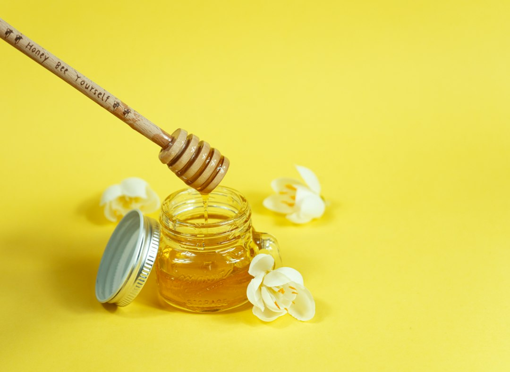

*This post contains affiliate links. As an Amazon Associate, I earn from qualifying purchases at no extra cost to you.*

Most new market vendors make the same expensive mistake. They extract a good crop, order five hundred matching jars and labels, and then discover that shoppers walk past the table. The honey was fine. The packaging, price, and pitch were guesses, and they were guesses made in bulk.

A better approach treats your first market season as a series of small experiments. You do not need a brand agency or a big budget. You need three or four clearly different products, packaging that costs little to change, and a simple way to record what shoppers pick up, ask about, and buy. A market table is a cheap research lab. A few hundred dollars of test inventory will teach you more than any amount of planning at the kitchen table.

My position is simple: build a small honey product line in tiers, test packaging before you commit to volume, and position your honey on one specific, true claim rather than on vague words like "pure" or "natural." This guide walks through how to do that, which packaging choices deserve scrutiny, how to run a four-week test, and the errors that quietly drain margin.

Photo by <a href="https://unsplash.com/@ionelaaaaa?utm_source=artlines_blog&utm_medium=referral">Ionela Mat</a> on <a href="https://unsplash.com/?utm_source=artlines_blog&utm_medium=referral">Unsplash</a>

## Why a honey product line beats a single jar

A single product forces every shopper into the same decision: buy this jar or leave. A honey product line gives different shoppers different ways to say yes. The commuter who wants something for tea buys the small jar. The person visiting relatives buys a gift. The regular buys the large refill-size jar every month.

A line also protects you from the quirks of honey itself. Crops vary by year and by forage, so a single flagship that depends on one flow can leave you with nothing to sell in a poor season. If you have a spring blend, a late-season dark honey, and a creamed or infused product, you can lean on whichever one the season produced.

Finally, a line makes testing possible. You cannot learn whether a kraft label outsells a cream one if you only make one product. With three or four products you can vary one thing at a time and compare.

Keep the line small. Market shoppers respond better to a table that looks curated than one that looks like a pantry. Three to five products is a workable ceiling for a first season, and extra SKUs add label design, inventory tracking, and compliance work on top of the honey itself.

Before you design anything, confirm what you are allowed to sell and how. Rules on cottage food, honey labeling, and market vending differ by state and sometimes by county. Our guide to [what regulations and licenses you need to start a honey business](/2026/10/04/starting-a-honey-business-what-regulations-and-licenses-you-need/) covers the groundwork, and your state department of agriculture is the final word.

## Structure your honey product line in three tiers

The simplest framework is three tiers: an anchor, a gift, and a discovery product. Each has a different job.

**The anchor** is your everyday honey in a familiar size. It sets your reputation and pays the bills. Price it with confidence, because shoppers at a market expect local honey to cost more than supermarket honey, and a price that is too low can read as a signal of lower quality.

**The gift** is the same honey, or a close relative, in packaging designed to be handed to someone else. Smaller jars, a cleaner label, and a tie or tag do most of the work. Gift products tend to carry the best margin per ounce, and they sell hardest in the weeks before the holidays.

**The discovery product** is the one that gets people talking: a single-source varietal, a creamed honey, a honey with a clearly labeled infusion, or a small sample size. It is the product that gets a shopper to stop, which gives you a chance to sell the anchor.

| Tier | Job | Typical format | Packaging priority | What to watch |
|---|---|---|---|---|
| Anchor | Repeat sales, reputation | Standard jar, your best-selling size | Clear, honest, easy to read | Price creep from competitors |
| Gift | Higher margin per ounce | Smaller jar, cleaner design | Appearance and presentation | Seasonal demand spikes |
| Discovery | Conversation and trial | Creamed, varietal, or sampler | Distinct look, clear description | Extra labeling and shelf-life questions |

The main tradeoff is complexity versus coverage. More tiers reach more shoppers but raise your design, inventory, and record-keeping load. For a first season, one product per tier is enough.

If you are building the business side alongside the product line, [building a profitable beekeeping side business](/2026/10/03/building-a-profitable-beekeeping-side-business/) is a useful companion for thinking through costs and capacity.

## Testing packaging: jars, labels, and legal basics

Packaging is where product-line testing earns its keep, because packaging is both your biggest visible variable and your biggest avoidable cost. The goal is to test cheaply first, then buy in volume only after a design has proven itself.

### Start with small, cheap test runs

Order small quantities of two or three jar styles before committing. A pack of twelve is enough to run a weekend comparison. One option for testing is the [MILIVIXAY 12 Pack Glass Candle Jars with Bamboo Lids, 12oz, Amber](https://www.amazon.com/dp/B0BLS7D87N?tag=mbbeekeeping-20). The listing describes it as a dishwasher-safe jar with an airtight lid that can also serve for spices, liquids, and samples. That makes it a reasonable candidate for gift sets or a discovery product.

Be careful here, though. These are marketed first as candle jars, and the product listing does not make a specific claim that the jar and lid are rated for direct food contact with honey. Before you fill and sell anything in them, check the listing and any manufacturer documentation for food-contact information, confirm the lid seals well enough for a viscous, hygroscopic product like honey, and wash and sanitize the jars yourself. If you cannot confirm food suitability, use them for display, sampling cups, or non-food gift bundling rather than as primary honey packaging. Standard glass honey jars or canning jars from a food-packaging supplier remain the safer default for your anchor product.

### Design the label for the front and the back

Labels do two jobs: they sell, and they comply. A pretty label that omits required information is a liability, so decide on content first and design second.

For a first test, printable round labels let you change designs without a print order. The [Avery Round Product Labels, 2.5", Kraft Brown, 225 Labels](https://www.amazon.com/dp/B005IMAOP6?tag=mbbeekeeping-20) are laser and inkjet printable, which means you can print a handful of variants at home and compare them on the same day. A 2.5 inch round is small, so treat it as a front-of-jar brand mark and put the regulated details on a separate back label or wrap. Kraft stock also pushes your look toward rustic and handmade, which suits some markets and not others, so test it against a cleaner option.

The FDA publishes [guidance on proper labeling of honey and honey products](https://www.fda.gov/regulatory-information/search-fda-guidance-documents/guidance-industry-proper-labeling-honey-and-honey-products). In general, labels need an accurate statement of identity (honey), a net quantity statement in the right place on the front panel, and the name and place of business of the producer. If you add anything to the honey, the ingredient list and name must reflect it. The FDA has not defined terms such as "raw," so avoid leaning on them as a technical claim. Your state may add its own requirements, especially under cottage food rules.

### Test one variable at a time

If you change the jar, the label, and the price in the same week, you will not know what caused the result. Pick one variable per market day. One Saturday compare two label styles on the same jar. The next, compare two jar shapes with the same label. Record sales for each.

Also test how the jar looks at the distance a shopper actually sees it, which is about six feet away while walking. Step back from your table and look. If the honey color, the product name, and the size are not obvious at that distance, simplify.

Storage behavior belongs in the test too. Honey crystallizes naturally, and a creamy or cloudy jar is not spoiled. Explaining that on a small card saves you from confused customers. Our guide on [how to store and preserve honey at home](/2026/06/20/how-to-store-and-preserve-honey-at-home/) is worth turning into a short handout.

## Positioning your honey product line: price, story, and shelf talk

Positioning is the answer to a simple question: why should a stranger pick your jar over the one beside it? Weak positioning relies on adjectives. Strong positioning relies on one specific, true fact.

### Pick one real claim

Good claims are checkable. "Harvested from hives within five miles of this market." "Late-summer goldenrod and aster honey." "Single yard, single harvest, extracted by hand." Each one gives a shopper something to repeat to a friend. Avoid claims you cannot support, such as health benefits, which can create regulatory trouble, or "pure" and "natural" as stand-alone selling points.

The National Honey Board at [honey.com](https://honey.com) offers consumer-facing information on honey varieties, color, and flavor that can help you describe your product accurately without overreaching.

### Price with a reason

Price is part of positioning. A practical approach is to calculate your true cost per jar, including the jar, lid, label, a share of equipment, market fees, and your time, then compare it to what other local honey sellers charge. Place your anchor product near the local norm unless you have a clear differentiator, and place the gift tier higher because the presentation justifies it.

Round numbers make cash handling easier at a busy table. Use price steps that are easy to add up, and consider a modest multi-jar discount for the anchor product to raise your average sale.

### Prepare a ten-second pitch

Shoppers give you a few seconds. Write a short line for each product: what it is, where it came from, and how it tastes. Practice it until it sounds like conversation. The pitch for the anchor might be about consistency and local source, the gift about presentation, and the discovery product about flavor.

Taste is the strongest argument you have, so sample when your rules allow it. Many markets and local health departments have specific sampling requirements, so ask the market manager before you set out spoons or cups.

## How to run a four-week market test

A structured test turns scattered impressions into decisions. This is a simple four-week plan using the same table and the same product line.

1. **Set a baseline in week one.** Bring your three-tier line with your current label and jar choices. Track units sold per product, number of people who stopped, and what they asked. A simple tally sheet works. This is the number you will try to beat.
2. **Change only the label in week two.** Swap in your alternative label design on one product, or run both side by side with the same jar. Keep price and display identical. Record sales for each version.
3. **Change only the price or bundle in week three.** Test a multi-jar discount, a small price change on the gift tier, or a bundled sampler. Hold the label constant at your week-two winner.
4. **Change only the display in week four.** Try the same products at a different height or arrangement, with a simple sign naming your one key claim. Compare to your earlier weeks.
5. **Review the numbers and decide.** Look at sales per product, sales per visitor, and the questions you heard most. Choose which products to scale, which to drop, and which packaging to order in volume.

Weather, holidays, and market attendance will skew any single week, so treat the results as directional rather than exact. If one week's foot traffic was unusually low, repeat the test before drawing conclusions. A comparison of two designs on the same day is more reliable than a comparison across different days.

Record the data the same way every time. A paper tally with columns for product, label version, price, and units sold is enough, and you can move it into a spreadsheet at home. If you already track hive records, our guide to [creating and maintaining inspection logs](/2026/10/06/creating-and-maintaining-inspection-logs-for-tracking-hive-health-data/) has habits that transfer well to sales tracking.

## Table display and sampling that supports the test

Display is packaging at the scale of your whole table. Height, grouping, and signage change what shoppers see first, and they affect your test results, so keep them consistent unless display is the variable you are testing.

Height is the easiest improvement. A flat table makes every jar look the same. Risers create layers, so your gift tier and your best seller can sit at eye level while the anchor stays within reach. A clear acrylic cube such as the [Cal-Mil CC312 Cube, 12" Height, 12" Width, 12" Length, Acrylic, Clear](https://www.amazon.com/dp/B00MRR5Y5A?tag=mbbeekeeping-20) can work as a display riser or product stand. It measures 12 inches on each side, so it takes up real table space and suits a hero product or a small gift stack better than a full line. Check the listing for weight limits before loading it with glass jars, and keep stacks stable on a windy day.

Keep signage short and consistent with your packaging. Repeat the same name, color, and claim on the label, the table card, and the price sign. Shoppers read repetition as professionalism.

Group by tier rather than by flavor so the structure of your line is obvious. Put the discovery product near the front where it can start conversations, and keep the anchor easy to grab and pay for. Leave a little empty space around products so the table does not look crowded.

Finally, keep your honey out of direct summer sun. Heat can degrade flavor and make jars look worse by midday. A canopy or shaded corner helps, and a table cloth that matches your label colors makes the whole presentation feel deliberate.

## Common mistakes that sink a honey product line

Most failures in a first market season come from a short list of avoidable errors.

**Ordering packaging in bulk before testing.** A thousand labels with a typo or an unpopular design is a sunk cost. Print small batches first and only scale a design that has sold.

**Skipping the compliance basics.** Missing net weight, the producer name and address, or an accurate statement of identity can get you shut down by a market manager or inspector. Check the FDA guidance and your state rules before design work, not after.

**Using candle-grade or non-food-rated containers without verification.** Jars sold for candles may be perfectly good glass, but you need to confirm food suitability yourself. If the listing does not say, do not assume.

**Changing too many things at once.** If the jar, label, and price all move together, you cannot learn which one mattered. One variable per market day is slower but far more useful.

**Pricing by fear.** Underpricing to avoid objections trains customers to expect low prices and leaves no room for market fees, packaging, or your time. Price from cost, then adjust from evidence.

**Making health claims.** Statements about curing allergies or illness invite regulatory attention and undermine trust. Describe flavor, source, and harvest instead.

**Ignoring crystallization.** Shoppers who do not know honey crystallizes may think a jar has gone bad. A short card or a quick explanation prevents returns and lost trust.

**Overbuilding the line.** Eight products with thin sales in each are harder to manage than four with clear roles. Cut products that do not earn their table space.

**Not keeping records.** Without a tally of what sold, you are choosing next season's packaging from memory, and memory favors the memorable conversations over the sales.

## FAQ

### How many products should be in a first-season honey product line?

Three to five products is a sensible range for a first season. A common structure is one anchor honey in a familiar size, one gift product with more refined presentation, and one discovery product such as a varietal, creamed honey, or sampler. That gives you something for repeat customers, something for gift buyers, and something that starts conversations. More than five products raises label design, inventory, and compliance work, and it can make the table look cluttered. You can always add products in season two once you know which tier is performing. Fewer products with clear roles also make your test results easier to interpret.

### Can I use candle jars or decorative jars for honey?

Only if you can confirm they are suitable for food contact. Jars marketed for candles may be made from perfectly ordinary glass, but the listing may not state food-safe suitability, and the lids and any liners may not be intended for food. Look for explicit food-contact information from the manufacturer, check that the lid seals tightly enough for honey, and wash and sanitize before filling. If you cannot verify these points, use the jars for non-food purposes such as display or packaging accessories. Standard honey jars and canning jars from food-packaging suppliers are the lower-risk choice, and your state or market rules may impose additional requirements.

### What information does a honey label need?

Requirements vary by state, but FDA guidance points to the essentials: a clear statement of identity such as "Honey," a net quantity statement placed correctly on the front panel, and the name and place of business of the producer. If you add ingredients to the honey, the label must reflect that accurately, including an ingredient list. Terms like "raw" are not formally defined by the FDA, so avoid treating them as technical claims. Because cottage food laws and market rules differ, confirm the specifics with your state department of agriculture before printing a large run. Test designs with small printable labels first, then order in volume once the content is confirmed.

### Conclusion
A honey product line does not need to be large or fancy to work. It needs a clear structure, packaging you have tested cheaply, one honest claim, and records that tell you what happened. Start with three products, run the four-week test, change one variable at a time, and let the numbers decide what to scale.

Your next step is concrete: choose your anchor, gift, and discovery products this week, confirm your labeling and cottage food requirements, and order a small test batch of jars and printable labels. Run your baseline at the next market, and write down every sale.

If this guide helped, bookmark it for your next packaging decision, or leave a comment with what you are testing at your table.

### Related reading
- [Building A Profitable Beekeeping Side Business](/2026/10/03/building-a-profitable-beekeeping-side-business/)
- [Starting A Honey And Value Added Bee Product Business Step By Step Guide](/2026/10/22/starting-a-honey-and-value-added-bee-product-business-step-by-step-guide/)

  
<strong>About the Author</strong>

  
The MB Beekeeping team researches backyard beekeeping practices, drawing on apiary science literature, extension service recommendations, and documented keeper outcomes. Our guides focus on practical hive management decisions that hold up under scrutiny.

