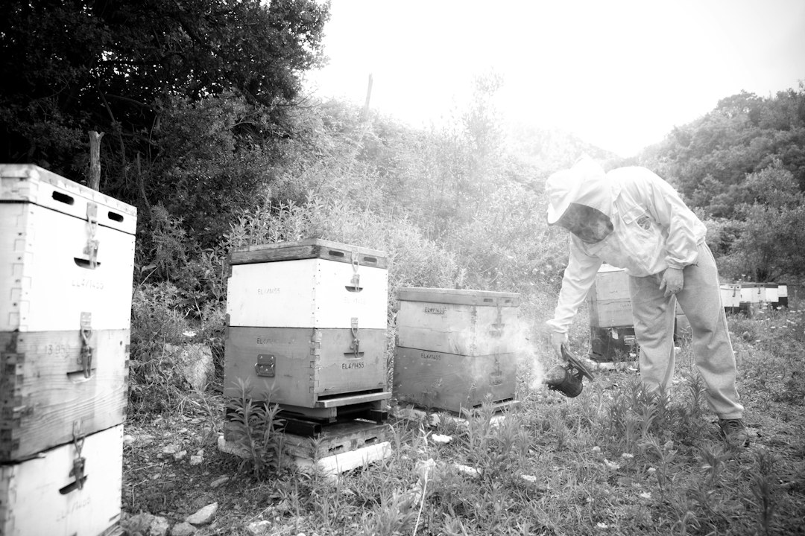

*This post contains affiliate links. As an Amazon Associate, I earn from qualifying purchases at no extra cost to you.*

You lift the lid and find a colony that looks wrong in a very specific way. Cells hold three, four, even six eggs, stuck to the walls instead of standing upright on the cell floor. The brood is patchy, and the cappings bulge like little bullets across what should be flat worker comb. There is no queen, no queen cells, and the bee population shrinks every week. That is a laying worker colony, and the sooner you accept what it means, the more bees and equipment you save.

The position of this guide is blunt: most laying worker colonies cannot be rescued by dropping in a new queen, and most are not worth the weeks of effort that cure attempts demand. For the typical backyard keeper, the fastest reliable fix is to disperse the colony or combine its bees into a healthy queenright hive, then rebuild later with a split or a protected queen cell. Below you will find how to diagnose the problem, decide whether any recovery attempt is justified, carry out a combine, and avoid the mistakes that waste a season.

Photo by <a href="https://unsplash.com/@beenaturalles?utm_source=artlines_blog&utm_medium=referral">Bee Naturalles</a> on <a href="https://unsplash.com/?utm_source=artlines_blog&utm_medium=referral">Unsplash</a>

## What Laying Workers Are and Why They Develop

Worker bees are female, but their ovaries are normally suppressed. Queen mandibular pheromone, along with pheromones from open brood, tells the colony that a functioning queen is present and that workers should not reproduce. Remove both signals for long enough and the suppression fades. In some workers the ovaries activate, and those bees begin laying eggs.

Those eggs are unfertilized. Workers cannot mate, so every egg they lay develops into a drone. That is the trap. A colony that depends on a steady supply of new workers is now producing only males. The existing workers age and die, the population shrinks, and the colony fails, often with plenty of stored honey still in the box.

Timing varies. Extension and beekeeping sources commonly describe laying workers appearing after a colony has been queenless and without young brood for roughly three weeks or more. Weak colonies, with few young bees to tend a queen or brood, can slip into the pattern at an unpredictable pace. The practical lesson is to catch queenlessness early. If your notes show no eggs on two consecutive inspections, you are already close to the point where fixes get harder.

The usual causes are predictable:

- **Failed mating.** A virgin queen is lost on her mating flight, or weather and drone shortages prevent mating.
- **Queen loss during handling.** A queen is crushed or lost during an inspection and the colony cannot raise a replacement.
- **Splits made without eggs.** A split with no eggs or young larvae cannot rear a queen, and the clock starts immediately.
- **Late-season queenlessness.** After drones are evicted in autumn, a queenless colony has no realistic path to a mated queen.
- **Chronic weakness.** Mite pressure, disease, or starvation leaves too few nurse bees to support a queen or brood.

If you suspect a failing queen rather than a missing one, the guidance in the [requeening a weak hive guide](/2026/10/15/requeening-a-weak-hive-when-and-how-to-replace-a-failing-queen/) covers when replacement makes sense and how to time it.

## How to Diagnose Laying Workers Versus a Drone-Laying Queen

Diagnosis matters because the two look similar and demand opposite responses. A drone-laying queen is a failing or poorly mated queen that you replace. Laying workers mean no queen at all, and replacement attempts usually fail. Misreading the signs can lead you to kill a salvageable queen or to waste a purchased one.

Look for these signs on a bright day, tilting each frame so sunlight shines into the cells:

- **Multiple eggs per cell.** Two to eight eggs in one cell is the classic sign.
- **Off-center eggs.** Workers have shorter abdomens than a queen, so eggs are often laid on the cell walls instead of at the bottom center.
- **Scattered, spotty brood.** Eggs and larvae appear in random cells instead of a tight, solid pattern.
- **Bullet caps.** Drone brood raised in worker-sized cells has domed, raised cappings.
- **No queen and no queen cells.** Colonies with well-developed laying workers rarely build emergency cells.
- **A dwindling bee population** with few young bees emerging.

The table below separates the three situations most often confused:

| Observation | Laying workers | Drone-laying queen | New queen just starting |
|---|---|---|---|
| Eggs per cell | Often 2 to 8, scattered | One, centered | Mostly one, occasional doubles |
| Egg placement | Walls and sides of cells | Cell floor | Cell floor |
| Capped brood | Raised bullet caps on worker comb | Raised caps, some worker brood early | Flat worker caps, pattern tightening |
| Queen present | No | Yes | Yes |
| Queen cells | Usually none | Possible supersedure cells | None |
| Best response | Disperse or combine | Replace the queen | Wait and monitor |

A test frame can add evidence. Place a frame of eggs and young larvae from a healthy colony into the suspect hive. Bees with no queen and no laying workers usually start emergency queen cells within a few days. Treat this as supporting evidence only, because a colony with established laying workers often ignores the frame or tears down cells. It also gives a failing hive a few extra nurse bees as brood emerges, which is a small bonus.

Rule out disease before you decide anything. Patchy brood is also a symptom of American foulbrood, European foulbrood, chilled brood, and mite damage. If cappings are sunken, greasy, or perforated, or you see a brown, ropy, foul-smelling residue, stop and read the [guide to identifying and treating American foulbrood](/2026/09/22/how-to-identify-and-treat-american-foulbrood/) and contact your state apiary inspector before moving any frames or bees. The USDA's [Animal and Plant Health Inspection Service](https://www.aphis.usda.gov/) is a starting point for locating regulatory contacts.

> **Safety note:** Weak, queenless colonies are often defensive and robbed-out hives attract stinging insects. Wear a veil and gloves, light your smoker before you open the box, and keep epinephrine on hand if you or a helper has a known sting allergy. If you suspect foulbrood, do not combine, share, or relocate equipment until an inspector or experienced mentor has confirmed the diagnosis.

## Should You Save the Colony? A Decision Framework for Laying Workers

Not every laying worker colony deserves a rescue attempt. A clear decision framework saves you from sentimental choices that cost both bees and time.

**Start with the calendar.** In late November across most of the northern United States and similar climates, there are no drones flying, mated queens are not locally available, and the colony cannot rear brood in cold weather. A laying worker colony at this point is a salvage job, not a recovery. Your goal is to preserve what can be preserved: usable honey and pollen frames, drawn comb, and any healthy workers that a strong neighbor can absorb. If you keep bees in a warm region with ongoing brood rearing, a spring or summer approach may still apply.

**Then count the bees.** Fewer than two or three frames of bees is usually too small to be worth combining. A tiny remnant adds little to a strong colony and may carry mites or disease with it. Shaking those bees out and reclaiming the equipment is faster and safer.

**Check mites and health.** A colony that collapsed from untreated varroa, nosema, or brood disease may be a poor candidate to merge into a healthy hive. If you have not tested mite load recently, do an alcohol wash or sugar roll first. The [Honey Bee Health Coalition](https://honeybeehealthcoalition.org/) publishes best management practice guides that cover mite monitoring and treatment thresholds.

**Confirm you have a receiving colony.** Combining only works if a strong, healthy, queenright hive is nearby. If every colony you own is weak, combining two failing hives rarely produces one thriving one.

Put it together as an if-then guide:

- **If it is late fall in a cold climate:** disperse or combine, store clean comb safely, and plan a spring split.
- **If it is spring or summer and you have a strong queenright hive:** combine with newspaper, as described below.
- **If it is spring or summer and you have a viable, healthy mid-sized colony and a queen cell or ripe nuc available:** try combining first. Only attempt a queen introduction after the laying workers have been diluted or removed.
- **If you see disease or heavy mite loads:** report suspected foulbrood, treat as needed, and do not merge.
- **If the colony is under two or three frames of bees:** shake it out and reuse the equipment.

## How to Fix Laying Workers: A Step-by-Step Newspaper Combine

The most dependable approach for backyard keepers is a newspaper combine. The strong colony's queen pheromone gradually reaches the laying workers while the slow chewing of the paper keeps the two populations from fighting. Most beekeepers consider it far more reliable than introducing a purchased queen directly into a laying worker hive.

1. **Confirm the diagnosis and inspect for disease.** Check for the signs above, then look at brood cappings for foulbrood symptoms and run a mite check. Stop here if anything looks like disease.
2. **Choose a receiving colony.** Pick a strong, queenright, disease-free hive with a good laying pattern. Ideally it sits close to the failing hive so returning foragers do not drift too far.
3. **Clean up the failing hive.** Remove frames of drone brood in worker cells, since they are mostly unproductive and attract wax moths and mites. Keep frames of capped honey and pollen. Scrape or freeze the drone brood and discard it away from the apiary.
4. **Prepare the receiving hive.** Place a single sheet of newspaper over the top bars of the strong colony's top box. Cut two or three short slits in the paper to speed the bees' work.
5. **Set the box on top.** Move the box of salvaged frames and bees directly over the newspaper. Keep the entrance of the lower colony as the only active entrance.
6. **Feed if the season allows.** A little syrup or a protein supplement above the combined cluster reduces robbing and supports the extra bees, as detailed in the next section.
7. **Check after five to seven days.** Confirm the paper is chewed through, the queen is still laying below, and there is no fighting. Remove excess boxes and consolidate frames as bee numbers settle.

A faster alternative, especially for small colonies, is the **shake-out**. On a calm afternoon, carry the hive 50 to 100 feet or more from its stand, shake all bees from the frames onto the ground, and remove the hive body. Foragers fly back to the old location, find nothing, and tend to beg entry into neighboring hives. The accepted theory is that laying workers, which behave differently from foragers, are less likely to return and are not accepted, though results are not guaranteed. Do this only when robbing risk is low, and read the guides on preventing robbing during a dearth before you start, because exposed honey frames and agitated bees attract robbers fast.

Do not skip the dilution principle. Whichever method you choose, you are not curing the laying workers so much as overwhelming them with a queenright population and its pheromones. For the broader timeline and best practices on merging weak units, the [guide to combining weak colonies for winter](/2026/10/17/combining-weak-colonies-for-winter-the-timeline-and-best-practices/) explains how to schedule and stage a merge.

## Supporting Recovery: Queens, Feed, and Equipment

Once the laying workers are gone or absorbed, your attention shifts to rebuilding. This is where the products you choose can help or waste money.

### Replacement queens

Do not place a queen into a hive with active laying workers. The laying workers tend to reject or kill a caged, unfamiliar queen, and you lose both the queen and the money. Queens belong in a colony that is demonstrably queenless and free of laying workers, or in a fresh split or nuc.

If you plan to order one for a spring rebuild, the [Queen listing](https://www.amazon.com/dp/B0747XTY7Z?tag=mbbeekeeping-20) is one candidate to evaluate. Treat it as unverified until you confirm the details: that it is a mated queen, how and when the seller ships, whether the breeder is state inspected, and what the return or replacement policy is. The [where to buy queen bees guide](/2026/06/27/where-to-buy-queen-bees-what-to-look-for-and-how-to-order/) walks through those checks.

### Protein support

Combined colonies and rebuilding splits can benefit from supplemental protein when natural pollen is scarce. A pollen substitute powder such as the [API Little Giant Bee-Pro Pollen Substitute Powder](https://www.amazon.com/dp/B06XY8FKS9?tag=mbbeekeeping-20) is one option to consider. Check the manufacturer's label for preparation and feeding guidance. The main tradeoff is timing. Extra protein stimulates brood rearing, which is helpful in spring but not wise in late autumn in cold regions, where it can encourage rearing that the cluster cannot sustain through winter.

### Feeding equipment

A frame feeder sits inside the hive body in place of a frame, so it is useful for a small combined colony that needs syrup without opening the box to the cold or robbers. The [5L frame feeder](https://www.amazon.com/dp/B0FT93NJH1?tag=mbbeekeeping-20) listing is a candidate worth checking against your equipment. Confirm that the dimensions fit your box depth and frame spacing, and that the design includes a ladder, float, or texture that gives bees a way out so they do not drown. Avoid liquid feeding when overnight temperatures stay low enough that bees cannot take and process syrup. In cold weather, dry sugar or fondant is the safer choice, a point covered in the [fall feeding protocols guide](/2026/11/17/strategic-fall-feeding-protocols-ensuring-winter-survival-and-spring-strength/).

### Equipment care

Store the empty boxes and drawn comb from the failed colony somewhere dry, cool, and protected from mice, wax moths, and small hive beetles. Freezing frames for 48 hours before storage is a common step to kill pests and eggs. Mark any equipment that came from a hive with disease symptoms and keep it separate until you are sure.

## Common Mistakes When Dealing With Laying Workers

Most failures with laying worker colonies follow a handful of predictable patterns.

**Waiting too long.** Beekeepers see a thin colony and a few drone cells and decide to wait until the next inspection. Every week lengthens the queenless period, increases the number of laying workers, and shrinks the population you could have combined. Act on the first confirmed diagnosis.

**Dropping a queen straight in.** This is the most expensive mistake. A caged queen introduced into a hive with developed laying workers is often attacked. If you want to try requeening, first combine or disperse, or protect the new queen in a fresh nuc and let her establish herself before merging.

**Misdiagnosing a drone-laying queen.** Killing or shaking out a hive that has a failing but living queen wastes a colony you could have fixed with a simple requeening. Always search for the queen and check egg placement before deciding.

**Skipping the disease check.** Spotty brood is not always laying workers. Merging a hive with foulbrood into a healthy one can spread a reportable disease through your whole apiary.

**Combining with a weak neighbor.** Two weak colonies seldom make a strong one. The receiving hive needs a healthy, productive queen and enough bees to absorb the newcomers.

**Leaving frames exposed.** Open honey frames and hive boxes after a shake-out invite robbing. Work in the afternoon when robbers are less active, close up equipment quickly, and reduce entrances on nearby hives.

**Repeated brood frame cycles with no plan.** Some beekeepers add frames of open brood weekly to suppress ovary development. This can occasionally work, but it drains your strong colonies, takes several weeks, and often fails once laying workers are established. Use it only if the colony is large, the season is favorable, and you have a queen or ripe queen cell ready.

**Ignoring the root cause.** If a colony fell into this state because of mites, poor nutrition, or starvation, merging it only hides the problem. Fix the underlying issue or you may repeat the failure next season.

## Frequently Asked Questions

### How long does it take for laying workers to develop?

There is no fixed timeline, but extension and beekeeping sources generally describe laying workers appearing after a colony has been queenless and without young brood for roughly three weeks or more. The pace depends on colony size, age of the bees, and whether any brood pheromone lingers. A small, weak colony can seem to decline quickly because few nurse bees remain, even before laying workers appear. The safest approach is not to rely on a calendar. If you find no eggs or young larvae and no queen on an inspection, treat the colony as at risk immediately, provide a frame of eggs from a healthy hive, and plan a decisive response before ovaries have time to develop.

### Can you requeen a hive with laying workers?

Rarely, and not by direct introduction. Laying workers generally reject or kill a caged, unfamiliar queen, which means you lose the queen and the money. A more reliable route is to combine the colony into a strong queenright hive, or shake out the bees and rebuild with a nuc or split. Some beekeepers have success with a protected, ripe queen cell after adding several frames of open brood from a strong colony, but results vary. If you want to try, do it with a large colony in good weather and be ready to fall back to a combine.

### Can I still harvest honey from a laying worker colony?

Usually yes, if the colony is free of disease and you have not treated it with products that restrict honey harvest during a flow. Stores left in a failing colony are often substantial, and capped frames of honey are commonly reclaimed during a combine. Confirm that the frames are free of brood and that you have no reason to suspect foulbrood or contamination before extracting. Keep reclaimed frames separate from your regular harvest until you are sure. If the colony died from suspected disease, do not extract or share the equipment, and consult your state apiary inspector before handling it further.

### Will laying workers stop on their own?

Almost never. Once ovaries are active and the colony remains without a queen, the behavior is self-reinforcing, since the colony keeps producing drones and no new workers. Occasionally a strong, populous colony with a ripe queen cell provided early enough returns to normal, but waiting and hoping is the most common route to a dead hive. Intervene with a combine or dispersal as soon as you confirm the diagnosis. The earlier you act, the more bees you can save and the less risk there is of robbing or wax moth damage in the abandoned hive.

## Conclusion

Laying workers are a symptom of a colony that lost its queen and its ability to replace her. The best response is usually decisive: confirm the diagnosis, rule out disease, and either combine the bees into a strong queenright hive or shake them out and reclaim the equipment. Do not try to fix the problem by dropping in a queen, and do not wait for the colony to sort itself out. Today, check your last three inspection notes for any hive without eggs, and if you find one, plan your combine this week. Use the failure as a prompt to tighten your mite checks, keep a spare nuc or queen cell source for next season, and keep better records.

If this guide helped, bookmark it for your next inspection day and leave a comment with the questions you want answered next.

**Related reading**

- [Requeening a Weak Hive: When and How to Replace a Failing Queen](/2026/10/15/requeening-a-weak-hive-when-and-how-to-replace-a-failing-queen/)
- [Combining Weak Colonies for Winter: The Timeline and Best Practices](/2026/10/17/combining-weak-colonies-for-winter-the-timeline-and-best-practices/)

  
<strong>About the Author</strong>

  
The MB Beekeeping team researches backyard beekeeping practices, drawing on apiary science literature, extension service recommendations, and documented keeper outcomes. Our guides focus on practical hive management decisions that hold up under scrutiny.

