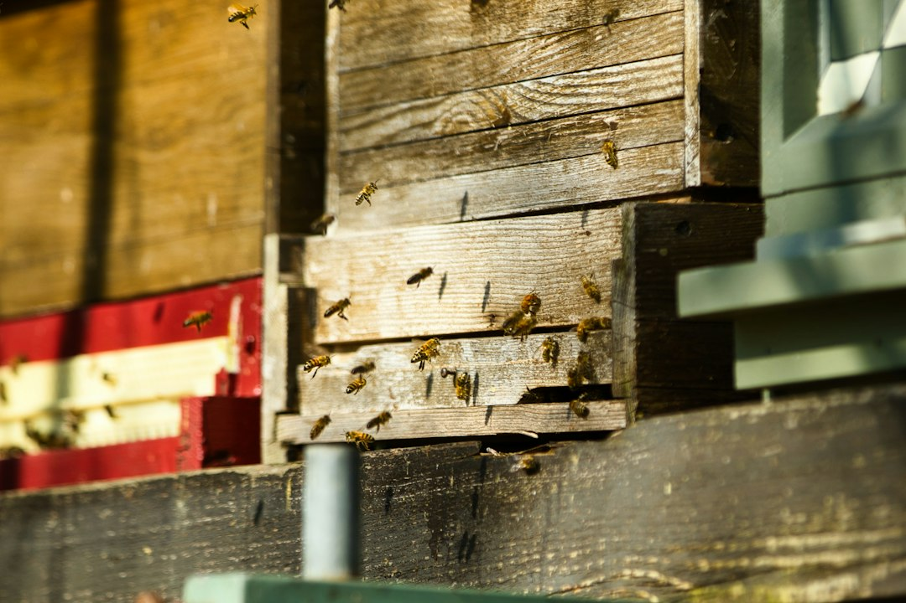

*This post contains affiliate links. As an Amazon Associate, I earn from qualifying purchases at no extra cost to you.*

Most winter colony losses come down to three problems: too little food, too much moisture, or too many mites going into the cold season. Cold alone is rarely the cause. A healthy cluster with enough honey can ride out surprisingly harsh weather, but a weak cluster sitting in a damp box with an empty pantry will fail in a mild one.

That shapes how you should think about winter protection. Wrapping, feeding, and hive preparation are not three separate chores. They are one system aimed at a single goal: a dry, well-fed, low-mite colony that can keep its cluster warm while it works through its stores. My position is simple. Feed first, manage moisture second, and wrap third. Wrapping gets the most attention, but it is the last piece, not the first.

This guide walks through the timeline, the feeding decisions, the wrap-or-don't-wrap question, and the ventilation details that make or break a colony in January. If you are still sorting out earlier fall tasks, start with [How To Prepare Your Apiary For Winter](/2026/06/10/how-to-prepare-your-apiary-for-winter/), then come back here for the cold-weather specifics.

Photo by <a href="https://unsplash.com/@paws_and_prints?utm_source=artlines_blog&utm_medium=referral">𝕡𝕒𝕨𝕤 𝕒𝕟𝕕 𝕡𝕣𝕚𝕟𝕥𝕤</a> on <a href="https://unsplash.com/?utm_source=artlines_blog&utm_medium=referral">Unsplash</a>

## What Actually Threatens a Colony in Winter

Honey bees do not hibernate. They form a tight cluster and generate heat by shivering their flight muscles, rotating bees between the cold outer shell and the warmer core. The cluster does not heat the whole hive. It heats itself, and the amount of fuel it burns depends on how cold the outer shell gets and how many bees are working.

That is why the biggest winter threats are rarely what beginners expect.

**Starvation.** A cluster can starve with honey in the box if that honey sits a few frames away during a cold snap. Bees move up and sideways through stores slowly in deep cold. Colonies often die with food just out of reach, which is why where the stores sit matters as much as how much there is.

**Moisture.** Bee metabolism produces water vapor. In a sealed, cold box, that vapor condenses on the inner cover and drips onto the cluster. Wet bees lose heat fast. Extension guidance from cold-climate bee programs consistently points to condensation as a bigger killer than low temperature alone.

**Mites and the viruses they spread.** Winter bees are the long-lived generation raised in late summer and fall. If mite loads were high while they developed, those bees carry weakened immune systems and shortened lifespans. No wrap fixes that. Mite control has to happen before the cold arrives, and the [Varroa Mite Management Natural And Chemical Treatment Options](/2026/09/24/varroa-mite-management-natural-and-chemical-treatment-options/) guide covers the options in detail.

**Small clusters.** A colony going into winter with fewer than roughly 6 to 8 frames of bees in cold regions has little thermal mass. Small clusters burn through stores faster per bee and have less margin for error. If a colony is marginal, combining is often the better call. See [Combining Weak Colonies For Winter The Timeline And Best Practices](/2026/10/17/combining-weak-colonies-for-winter-the-timeline-and-best-practices/) for how to do it without triggering fights.

Understanding these four threats makes every later decision easier. Each piece of equipment or task you add should address at least one of them.

## Your Winter Hive Preparation Timeline

Timing matters because several tasks are only possible while it is still warm enough to open the hive. Exact dates shift with your climate, so work from temperatures rather than the calendar. Use the sequence below as a template and adjust it to your region's first hard frost.

1. **Finish mite treatment and confirm results (late summer to early fall).** Test again after treatment. Extension and Honey Bee Health Coalition guidance generally aims to keep mite counts low heading into the winter bee period. If counts are still elevated after treatment, address it immediately, because later options narrow as temperatures drop.
2. **Assess colony strength and decide who goes in, who gets combined.** Count frames of bees and look at the brood pattern. Weak, queenless, or failing colonies are better combined than carried through winter on hope.
3. **Reduce space and arrange the stores.** Remove empty supers. The cluster should not have to defend or warm unused space. Make sure heavy honey frames sit around and above the cluster.
4. **Feed to target weight (early to mid fall).** Use syrup while daytime temperatures still allow bees to process it. Details are in the feeding section below.
5. **Install mouse guards and reduce the entrance (before nights drop near freezing).** Mice move in once temperatures fall and they chew comb. Install guards before the cold sets in, not after you find the damage.
6. **Set up moisture management (late fall).** Add an upper entrance or a moisture-absorbing quilt box, and tilt the hive slightly forward so condensation runs out the front rather than pooling.
7. **Wrap or windbreak if your climate calls for it (after the last full inspection, before deep cold).** Do this once, make it secure, and leave the bees alone.
8. **Heft-check and monitor through winter without opening the box.** Lift the back edge of the hive periodically, watch the entrance on warm days, and plan emergency feeding for any colony that feels light.

The order matters. Wrapping a colony that is light on stores or still carrying heavy mite loads just gives you a well-insulated failure.

## Feeding for Winter: How Much, What Kind, and When

Feeding is the highest-leverage task on this list. In cold climates, a common target is roughly 60 to 90 pounds of stored honey and syrup stores in the hive for a full-size colony, though the number varies with your winter length and local forage. Warmer regions need less, and colonies there may still fly and forage on mild days. Ask local experienced keepers or your state bee program for the regional figure rather than relying on a generic number.

### Fall syrup

Fall syrup is typically mixed at about 2 parts sugar to 1 part water by volume, a thicker mix than spring syrup because bees need less processing to cure it. The practical limit is temperature. Syrup feeding slows sharply once daytime temperatures stay below about 50 degrees Fahrenheit, because bees cannot process and cap the stores effectively. Uncured syrup in the cluster area can add moisture to an already damp winter box. If you are behind schedule, move to solid feeding rather than forcing syrup into cold weather.

A high-capacity top feeder is the easiest way to deliver fall syrup in volume without disturbing the brood nest every few days. The [Mann Lake Top Hive Feeder with Unpainted Wood Super](https://www.amazon.com/dp/B0CV326PX4?tag=mbbeekeeping-20) pairs a single-piece plastic reservoir with a galvanized steel safety screen. Top feeders suit fall feeding because they hold a large volume of syrup above the cluster. Check the listing against your hive body dimensions before buying, and note that a feeder with a super must be removed or replaced before you wrap and close the hive for winter.

### Solid winter feeding

Once syrup is off the table, solid feed is the safety net. Fondant, sugar bricks, and candy boards sit directly above the cluster and give bees food they can reach without leaving the cluster. Dry sugar sprinkled on newspaper is a common emergency option. The main advantage is that solid sugar absorbs and releases moisture rather than adding to it, so it works with a moisture-management plan instead of against it.

Put emergency feed on before you think you need it. Opening a hive in deep cold to add food is risky, and the colonies that need it most are the ones least able to recover from the disturbance.

### Where pollen patties fit

Protein feeding has a narrower role in winter than many keepers assume. The [Mann Lake Bee-Pro Patties](https://www.amazon.com/dp/B00B8L5UMS?tag=mbbeekeeping-20) are marketed as a spring and fall brood builder, and that is the right framing. In early fall, a patty can support the rearing of those critical winter bees when natural pollen is running out. In the dead of winter, though, you generally do not want to push brood rearing early in cold regions, because a colony that starts raising brood too soon burns stores faster and can chill brood during cold snaps.

A practical approach: use patties in early fall if natural pollen has dried up and the colony is still raising brood, then hold off until late winter or early spring based on your region. For the full seasonal logic, see [Pollen And Protein Feeding Strategies For Year Round Colony Development](/2026/10/08/pollen-and-protein-feeding-strategies-for-year-round-colony-development/).

## Winter Wrapping: Does Your Colony Need It?

Wrapping is useful, but it is not magic and it is not universal. The honest answer is that wrapping helps most in places with sustained deep cold, high winds, and exposed hive sites, and it helps least where winters are mild or the hive already has a good windbreak.

What a wrap actually does is reduce wind chill, absorb some solar heat on sunny days, and slow heat loss from the box. A colony that burns less energy keeping warm burns less honey, which is the real benefit. A wrap is effectively a way to stretch your stored food.

What a wrap does not do is fix moisture. A fully sealed, wrapped box with no ventilation can trap condensation and make things worse. This is the most common wrapping failure, and it is why the ventilation section below matters as much as the wrap itself.

### Choosing a wrap

Insulated wraps are the simplest option if your hive matches the dimensions. The [Bee Cozy Winter Bee Hive Wrap](https://www.amazon.com/dp/B07X1TYRP2?tag=mbbeekeeping-20) is listed for a 10-frame, 2-story deep setup, so it suits the common two-deep overwintering configuration. If you run a different configuration, such as three mediums or an 8-frame box, confirm the fit before ordering, since a wrap that gaps at the bottom or top loses most of its value.

Homemade alternatives include rigid foam board, tar paper over the sides, or burlap and straw bales stacked as a windbreak. Each can work. The trade is convenience versus customization. A purpose-made wrap goes on quickly and tends to be reusable for several seasons, while homemade setups cost less but require more care to seal against wind and keep out water.

### Wrapping rules that matter

- **Leave the entrance open.** Never wrap over the lower entrance. Bees need it for cleansing flights on mild days and for airflow.
- **Keep the top ventilated.** Insulate the sides but do not seal the top so tightly that vapor has nowhere to go.
- **Avoid wrapping too early.** Wrapping in warm fall weather can overheat the cluster and encourage bees to keep brood rearing and burning stores. Wait until consistently cold weather settles in.
- **Secure against wind.** A loose wrap that flaps becomes a stressor. Strap it down firmly.
- **Pair it with a windbreak where possible.** A fence, shrub line, or stacked bales on the prevailing wind side does a lot of the work for free.

If you are in a region where winter lows rarely stay below freezing for long, a wrap may add cost without much benefit. Spend that money on extra feed instead.

## Ventilation, Moisture, and Entrance Management

Winter protection fails most often in the details of airflow. The goal is not to keep the box warm. It is to keep the cluster warm while letting moist air escape. Warm, wet air rises to the top of the box, hits the cold inner cover, and condenses. You want that condensation to go somewhere other than onto the bees.

There are three common approaches, and you can combine them.

**Upper entrance.** A small notch or drilled hole near the top of the hive lets warm moist air exit and provides an escape route if the lower entrance clogs with dead bees or snow. It is simple and widely used.

**Quilt box.** A shallow box filled with wood shavings or similar absorbent material sits above the cluster, absorbing vapor and preventing it from condensing on a cold surface. It is more effort to build but handles moisture passively all winter.

**Forward tilt.** Tilting the hive slightly forward lets any condensation that does form run toward the entrance instead of pooling inside. A small shim under the back of the bottom board is enough.

Entrance reducers deserve a mention too. A reduced entrance keeps out mice and cuts drafts, but a fully closed or very tiny opening can be blocked by dead bees. Check the entrance after snow or ice and keep it clear. A quick brush with a stick on a mild day can prevent a nasty ventilation problem.

Monitoring tools can help here, because you cannot open the box to check conditions. If you want data on cluster temperature and humidity without disturbing the colony, [Best Hive Monitoring Equipment And Data Logging Tools For Backyard Beekeepers](/2026/11/07/best-hive-monitoring-equipment-and-data-logging-tools-for-backyard-beekeepers/) covers the options. For cold-climate overwintering research and practical guidance, the [University of Minnesota Bee Lab](https://beelab.umn.edu/) is a reliable starting point, and the [Honey Bee Health Coalition](https://honeybeehealthcoalition.org/) publishes best-practice resources on mite control and colony health heading into winter.

## Comparing Winter Protection Options by Climate

The right setup depends on how cold, how windy, and how long your winter is. This table summarizes a reasonable starting point. Treat it as a framework, not a rulebook, and adjust based on local advice.

| Climate / Situation | Wrap | Feeding priority | Moisture control | Notes |
|---|---|---|---|---|
| Mild winter, frequent flight days | Usually unnecessary | Moderate stores, watch for late-winter starvation | Upper entrance, forward tilt | Bees may still brood early, so check stores often |
| Moderate cold, occasional deep freezes | Optional, helpful on exposed sites | Full fall feeding, emergency fondant ready | Upper entrance or quilt box | Windbreak often matters more than a wrap |
| Long, cold winters with wind | Recommended | Heavy fall feeding, solid feed on top | Quilt box plus upper entrance | Combine weak colonies, wrap after cold settles |
| Exposed site, high winds | Strongly recommended with windbreak | Heavy stores plus emergency feed | Quilt box, secured top | Strap everything down |
| Weak or small cluster | Wrap will not rescue it | Not enough to compensate | Not the main issue | Combine in fall instead |

The pattern is consistent. Climate dictates how much insulation you need, but feeding and moisture control apply almost everywhere. If you can afford only one upgrade, put it into stores and ventilation before insulation.

## Common Winter Protection Mistakes to Avoid

Most winter failures trace back to a short list of repeat errors. Knowing them lets you sidestep the majority of preventable losses.

**Wrapping a hive that is still too warm or too early.** A wrap installed in October on a sunny day can keep the colony active and burning stores long before it needs the insulation. Wait for consistent cold.

**Sealing the box tight.** Beginners often assume more insulation and less airflow is better. It is the opposite for moisture. A sealed, wrapped hive with no upper ventilation can produce dripping condensation that chills the cluster. Insulate the sides, ventilate the top.

**Feeding syrup too late.** Pouring thin syrup into a hive once nights are near freezing adds uncured, watery stores and raises moisture. Switch to fondant or sugar once syrup uptake slows.

**Skipping the mite check.** Wrapping and feeding cannot offset a heavy mite load carried by the winter bee generation. If you did not test and treat in late summer, that is the first problem to fix next year.

**Carrying weak colonies through winter.** A small cluster with a marginal queen rarely survives on insulation alone. Combine them in fall, and use the result to build stronger splits in spring.

**Opening the hive in deep cold.** A lid lifted at 20 degrees Fahrenheit breaks the cluster's thermal seal and can chill brood. Use heft checks and entrance observation instead, and open only on a rare mild day with a specific reason, such as adding emergency feed.

**Forgetting mouse guards.** Mice move in as temperatures drop and can destroy comb and disturb the cluster. Install guards before cold nights arrive.

**Ignoring the entrance after snow.** A blocked entrance cuts ventilation and traps dead bees. Check it after storms and clear it gently.

If a colony does die, do not just clean up and move on. Look at the evidence. Dead bees clustered with food nearby suggest isolation starvation. Dead bees head-first in cells with empty comb suggest true starvation. Wet, moldy comb points to moisture. Spotted frames and bee remains with signs of dysentery can point toward nosema, which is covered in [Treating Nosema In Honey Bee Colonies](/2026/07/26/treating-nosema-in-honey-bee-colonies/). The cause tells you what to change next year.

## FAQ

### How much honey does a colony need to survive winter?

It depends on your climate, but in cold regions a full-size colony typically needs roughly 60 to 90 pounds of honey or stored syrup to reach spring. Warmer regions need less because bees break cluster to fly and forage more often. The reliable way to judge is to heft the hive, comparing the weight to what local experienced keepers consider adequate, and to check frames before the cold arrives. When in doubt, err toward heavier, since leftover honey is never wasted and a starved colony cannot be rescued by hindsight.

### Should I wrap my hive if my winters are mild?

Probably not as a priority. In mild climates, bees fly often, moisture escapes more easily, and insulation adds cost without much benefit. A windbreak and a good upper entrance usually do more. Put your money into adequate stores and mite control instead. If you get occasional hard freezes, a wrap can still help on an exposed site, but it should never replace feeding. The main tradeoff is that wrapping too early or too tightly in a mild area can actually keep colonies overactive and burning stores, which works against you.

### Can I feed pollen patties in the middle of winter?

Generally, it is better to wait. Patties encourage brood rearing, and in cold regions, early brood production burns stores and exposes brood to chilling during cold snaps. Patties fit best in early fall, to support winter bee rearing, or in late winter to early spring, when you want buildup to begin. Timing varies by region, so check with local keepers or your state apiary program. If you are unsure, prioritize carbohydrate stores and fondant over protein until days start lengthening and natural pollen appears.

### What is the best way to prevent condensation in a winter hive?

Give moist air a way out and keep it from condensing on the bees. An upper entrance lets vapor escape, a quilt box with wood shavings absorbs moisture before it condenses, and a slight forward tilt sends any drips toward the front instead of onto the cluster. Insulate the sides to keep the box warmer, but avoid sealing the top completely. Combining an upper entrance with a quilt box and a small forward tilt covers the most bases, and each piece is inexpensive compared to losing a colony.

### Conclusion
A colony that enters winter strong, low in mites, heavy with stores, and equipped with a dry, ventilated box has excellent odds. Wrapping is a helpful finishing layer in cold, windy regions, but it works only when feeding and moisture control are already handled. Start with the fundamentals, add insulation if your climate demands it, then stay out of the hive and let the cluster do its job.

Your next action: pick up a hive scale or simply heft each box this week, note which colonies feel light, and put fondant or sugar on those before the next hard freeze.

Bookmark this guide and check back before your first deep freeze so you have the timeline and wrapping rules handy.

### Related Reading
- [Monthly Beekeeping Schedule Inspection Tasks And Seasonal Priorities](/2026/11/08/monthly-beekeeping-schedule-inspection-tasks-and-seasonal-priorities/)
- [Spring Buildup Strategies Feeding And Brood Pattern Optimization](/2026/11/03/spring-buildup-strategies-feeding-and-brood-pattern-optimization/)

  
<strong>About the Author</strong>

  
The MB Beekeeping team researches backyard beekeeping practices, drawing on apiary science literature, extension service recommendations, and documented keeper outcomes. Our guides focus on practical hive management decisions that hold up under scrutiny.

